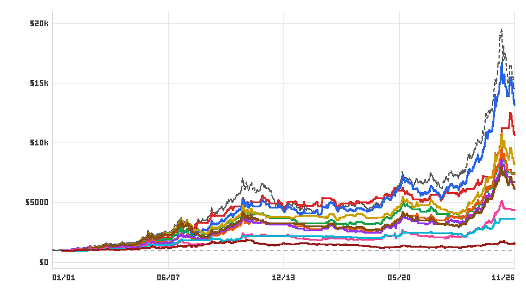
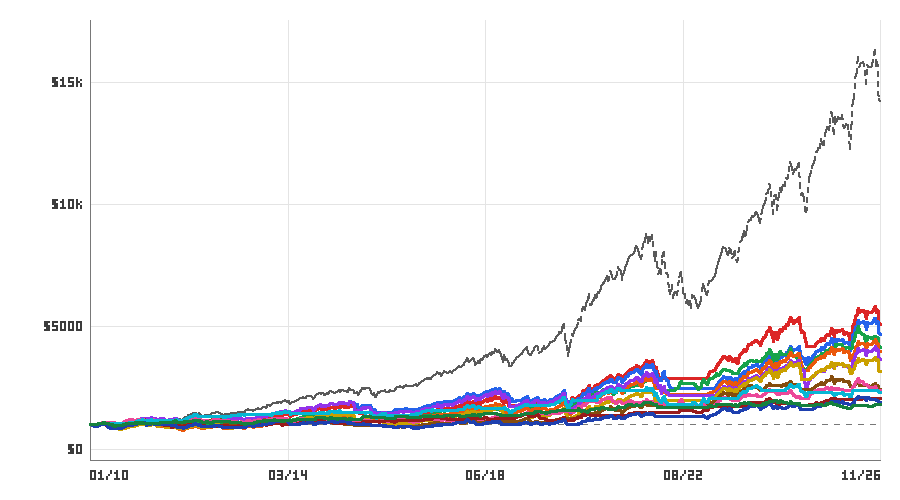

# 🇺🇸 Nasdaq 100 + 🥇 Gold — Paper Bot

> **Nasdaq en premier** : marché par défaut du panneau (`/menu`, `/graphique`, `/historique`), du résumé du jour, des bilans et du jeu. L'or continue de trader ; `/menu or`, `/graphique or`, `/historique or` pour l'or.

Bot Telegram qui **trade l'or et le Nasdaq 100 en simulation** (paper trading) avec plusieurs stratégies en parallèle et publie chaque
entrée, chaque sortie et un bilan régulier sur un canal Telegram. Les stratégies actives par défaut ont été choisies
par un **banc d'essai sur 6 ans** de données (voir plus bas).

> ⚠️ **Simulation uniquement.** Aucun ordre réel n'est passé, aucun compte de trading n'est utilisé.
> Ce n'est pas un conseil financier.

## Fonctionnement

```
Toutes les 3 minutes
  │
  ├─ Prix de l'or : PAXG/USD (1 PAXG = 1 once d'or) — Coinbase, secours Kraken (gratuit, sans clé)
  ├─ Stops / objectifs : vérifiés sur les bougies 5 min
  ├─ Signaux : chaque stratégie est évaluée à la clôture de chaque bougie de SON unité de temps (1 h, 6 h ou 1 jour)
  │
  └─► Ouvertures / clôtures publiées sur le canal + bilan toutes les SUMMARY_HOURS
```

- Chaque stratégie a **son propre compte simulé** : `GOLD_SIZE_USD` (1 000 $ par défaut) par trade, long ou short.
- Frais / spread simulés : 0,05 % à l'entrée et à la sortie.
- Une **référence achat-conservation** (acheter et garder) sert de point de comparaison dans le bilan.
- Les positions sont gardées dans `data/gold.json` (elles survivent à un redémarrage).

## Stratégies actives par défaut (or)

Choisies par le banc d'essai sur **25 ans d'or** (future GC=F, 2000 → 2026 : choix sur 2000–2015, vérification sur
2016–2026, `npm run research -- goldlong`) et confirmées sur le PAXG 2020–2026.

| Stratégie | Idée | 2001 → 2026 (réinvesti) | Pire baisse |
|---|---|---|---|
| 🆕 **Saison OU tendance** (`seasonplus`) | saison d'août à février, et le reste de l'année si l'or est 2 % au-dessus de sa moyenne 200 j | **+10,5 %/an** | −30 % |
| **Saison de l'or** (`season`) | investi d'août à février (demande physique : Inde, Nouvel An chinois), dehors de mars à juillet | **+9,6 %/an** | **−22 %** |
| 🆕 Momentum 12 mois sauf le dernier (`mom12_1`) | hausse sur 12 mois en ignorant le dernier mois (Jegadeesh & Titman) | +8,4 %/an | −34 % |
| 🆕 Croix dorée (`golden`) | investi tant que la moyenne 50 j est au-dessus de la moyenne 200 j | +8,1 %/an | −35 % |
| 🆕 Tendance sur 4 horizons (`trendmix`) | investi si l'or a monté sur au moins 3 des horizons 1, 3, 6 et 12 mois | +8,0 %/an | −31 % |
| **Filtre moyenne 200 jours** (`sma200`) | investi au-dessus de la moyenne 200 j (marge 2 %) | +7,7 %/an | −39 % |
| **Momentum 12 mois** (`mom12`) | investi tant que l'or a monté sur 12 mois (Antonacci) | +7,3 %/an | −40 % |
| Momentum de tendance (`tsmom`) | prix > moyenne 200 j et hausse sur 3 mois | +5,9 %/an | −30 % |
| Nouveau plus haut annuel (`high52`) | achat au plus haut de 52 semaines, revente au plus bas de 50 jours | +5,1 %/an | −18 % |
| MACD + EMA 200 (`macd@1d`) | croisement MACD dans le sens de l'EMA 200 | +1,8 %/an | −38 % |
| *Référence : garder l'or* (`hold`) | achète une fois et garde | *+10,8 %/an* | *−44 %* |



**À retenir** : sur 25 ans, la **saison de l'or** fait presque aussi bien que garder l'or avec **deux fois moins de baisse**,
et fait mieux sur 2021–2026 (+12,9 %/an contre +12,7 %). Les stratégies choisies au départ sur seulement 4 ans de PAXG
(Dollar + or, MM 10/60, Vote, EMA 20/50) **ne tiennent pas sur 25 ans** (entre −1 et +1 %/an) : elles restent
disponibles mais ne sont plus actives. Les filtres « taux US 10 ans », « indice du dollar » et « valeur refuge (VIX) »
ont été testés et sont perdants sur 2000–2015.

Nouvelles testées mais non activées : `season200` (saison ET tendance, +6,6 %/an), `dualmom` (double momentum or /
Nasdaq, +4,2 %/an mais −43 %), `silver` (argent en tête, +2,9 %/an), `riskoff` (refuge quand la Bourse baisse, perdante).

Toutes les autres restent disponibles (`GOLD_STRATEGIES`, voir Réglages) : `vote`, `dollar`, `sma1060@1d`, `ema@1d`,
`fibo@6h`, `vixcalm`, `yields`, `dxy`, `fear`, `breakout`, `meanrev`, `supertrend`, `pvt`, `turtle`, `ichimoku`…,
et n'importe laquelle sur une autre unité (`ema@6h`…).

### Nouvelles stratégies or (`npm run gold-new`, `src/gold2.js`)

| Stratégie | Idée | Résultat |
|---|---|---|
| **Rebond après une mauvaise semaine** (`g_weekrev`, journalier) | −3 % en 5 séances au-dessus de la moyenne 200 j → achat, revente au plus haut de 5 séances | ✅ +29 % cumulés 2000–2015, +63 % 2016–2026, 77 % gagnants |
| **Plus bas de 10 jours** (`g_low10`) | clôture au plus bas de 10 séances au-dessus de la moyenne 200 j → achat | ✅ +35 % puis +56 %, 67 % gagnants |
| **Chute rapide des taux** (`g_yieldfall`) | taux 10 ans −5 % en 5 séances et or > moyenne 50 j | ✅ +17 % puis +38 % |
| L'argent prend de l'avance (`g_silverlead`) | l'argent fait 5 points de mieux que l'or sur 10 séances | ✅ +17 % puis +10 % (plus faible) |
| **Séance asiatique** (`g_asia`, 5 min) | RSI 2 dans la tendance 1 h entre 0 h et 6 h UTC | ✅ +36 % 2020–2024 mais +2,7 % depuis ; pas ajoutée au compte FTMO (réussite récente 59 → 57 %) |
| Chute rapide du dollar (`g_dollarfall`) | | ❌ −10 % sur 2000–2015 |

Toutes actives sur le compte or (paper trading).

## 📈 Portefeuille (gains réinvestis)

Chaque stratégie a **son propre compte**, qui démarre avec `GOLD_START_CAPITAL` (1 000 $) et **mise tout son capital**
(`GOLD_POSITION_PCT` = 100 %) à chaque trade : les gains sont réinvestis, les pertes aussi.

- La valeur de chaque compte est enregistrée **toutes les heures** (`data/gold.json`).
- Un **graphique de l'évolution** est publié sur le canal chaque jour (`CHART_HOURS`), et à la demande avec `/portfolio`.
- `/simulation [or|nasdaq] [année]` rejoue les stratégies actives sur l'historique avec réinvestissement (or : depuis 2001 avec le future GC=F, depuis 2021 avec le PAXG).

### Historique simulé 2021 → oct. 2026 (1 000 $ au départ par stratégie, frais inclus)


| | Stratégie | Valeur finale | Pire baisse |
|---|---|---|---|
| 🟪 | Croisement MM 10/60 | 2 037 $ (+104 %) | −23 % |
| ⬛ | *Référence achat-conservation* | *2 019 $ (+102 %)* | *−30 %* |
| 🟦 | Vote de 5 signaux | 1 819 $ (+82 %) | −24 % |
| 🟧 | Momentum de tendance | 1 804 $ (+80 %) | −22 % |
| 🟥 | **MACD + EMA 200** | 1 682 $ (+68 %) | **−9 %** |
| 🟩 | Dollar + or | 1 623 $ (+62 %) | −16 % |
| 🟫 | Convergence Fibonacci | 1 388 $ (+39 %) | −16 % |
| 🟨 | EMA 20/50 | 1 196 $ (+20 %) | −10 % |

Toutes gagnent, **aucune ne bat nettement le simple achat-conservation** sur une période où l'or a doublé,
mais elles subissent des baisses bien plus faibles (MACD + EMA 200 : −9 % au pire, contre −30 %).

## Banc d'essai (`npm run research`)

**Données** : PAXG/USDT en 1 h depuis l'archive publique de Binance, **sept. 2020 → oct. 2026** (54 000 bougies),
agrégées en 6 h et en journalier, + EUR/USD (même archive) pour la stratégie dollar.
**23 stratégies × 3 unités de temps = 67 combinaisons** testées.

**Méthode** : les combinaisons sont **choisies** sur sept. 2020 → juin 2024 avec une règle fixée à l'avance
(gain > 0, profit factor ≥ 1,15, ≥ 20 trades, positive ≥ 60 % des années), puis **vérifiées** sur juil. 2024 → oct. 2026,
période qu'on ne regarde pas pour choisir. Test répété avec des frais doublés et d'autres dates de coupure.

### Ce qu'on a appris
1. **En bougies 1 h, tout perd** sur la période de choix — y compris les stratégies maison. Les frais et le bruit
   mangent tout. Les 5 stratégies d'origine tournaient en 1 h : c'est pour ça qu'elles perdaient.
2. **En journalier, plusieurs stratégies gagnent.** Une seule est retenue dans **toutes** les variantes du test
   (frais 0,05 % et 0,1 %, coupures 2023, 2024, 2025) et reste positive en vérification à chaque fois :
   **MACD + EMA 200 en journalier**. Elle gagne **chaque année de 2021 à 2026**, à l'achat (+435 $) comme à la vente
   (+78 $), avec une perte maximale de 68 $ sur 6 ans.
   Le **vote de 5 signaux** (journalier) est retenu dans 3 variantes sur 4 et toujours positif en vérification ;
   **dollar + or** est positif en vérification à chaque fois mais plus sensible aux frais.
   Ichimoku, ADX, Heikin-Ashi, compression de Bollinger, alignement de moyennes et inside bar ne sont pas retenus.
3. Elles font **moins que l'achat-conservation** en valeur absolue (l'or a doublé sur la période), mais avec beaucoup
   moins de temps en position et des pertes maximales bien plus faibles.

### Résultats des stratégies actives (1 000 $ par trade, frais 0,05 %)

| Combinaison | Choix 2020→mi-2024 | Vérif mi-2024→2026 | 2021 | 2022 | 2023 | 2024 | 2025 | 2026 |
|---|---|---|---|---|---|---|---|---|
| **MACD + EMA 200 (1 j)** | **+243 $** | **+232 $** | +20 | +71 | +116 | +42 | +151 | +74 |
| **Vote de 5 signaux (1 j)** | +128 $ | +496 $ | −158 | +98 | +55 | +127 | +188 | +313 |
| Dollar + or (1 j) | +75 $ | +374 $ | −39 | +80 | +121 | +53 | +87 | +237 |
| Momentum de tendance (1 j) | +64 $ | +606 $ | −71 | −34 | +38 | +228 | +508 | +1 |
| MM 10/60 (1 j) | +73 $ | +665 $ | −92 | −4 | +3 | +193 | +146 | +482 |
| EMA 20/50 (1 j) | +221 $ | +65 $ | +97 | +18 | +63 | −58 | +41 | +95 |
| Convergence Fibonacci (6 h) | +109 $ | +246 $ | −88 | +117 | −21 | +108 | +31 | +207 |
| *Achat-conservation* | *+168 $* | *+688 $* | | | | | | |

Attention : la période de vérification est une forte hausse de l'or, qui avantage les stratégies acheteuses.
Avec 67 combinaisons testées, quelques-unes peuvent sembler bonnes par hasard : c'est pour ça que le paper trading
en direct continue de les départager. **Résultats passés ≠ résultats futurs.**

Pour relancer : `npm run research` (frais 0,05 %), `npm run research -- 0.1` (frais 0,1 %),
`npm run research -- 0.05 2023-07-01` (autre coupure). Les données sont mises en cache dans `data/research/`.

## 🇺🇸 Nasdaq 100 en paper trading

Le bot trade aussi le **Nasdaq 100** en simulation, comme un CFD NAS100 :
- Prix : **indice ^NDX** via Yahoo Finance (gratuit, sans clé, non officiel), bougies 5 min pour les stops.
- Stratégies (retenues par le banc d'essai : choix 1985–2009, vérification 2010–2026, **achat seul** car vendre le Nasdaq
  à découvert fait perdre sur le long terme) — résultats 2010–2026 avec gains réinvestis :

| Stratégie | Idée | CFD (financement 6 %/an) | Sans financement |
|---|---|---|---|
| 🆕 **Croix dorée** (`golden`) | moyenne 50 j au-dessus de la moyenne 200 j | **+10,1 %/an**, pire baisse −30 % | |
| 🆕 **Momentum 12 mois sauf le dernier** (`mom12_1`) | hausse sur 12 mois en ignorant le dernier mois | +9,6 %/an, −33 % | |
| 🆕 **Feu vert macro** (`macro`) | au moins 2 feux verts sur 3 : indice > moyenne 200 j, VIX bas, taux 10 ans en baisse | +8,8 %/an, **−21 %** | |
| 🆕 Tendance sur 4 horizons (`trendmix`) | hausse sur au moins 3 des horizons 1, 3, 6 et 12 mois | +8,6 %/an, −30 % | |
| **Momentum 12 mois** (`mom12`) | investi tant que l'indice a monté sur 12 mois | +8,0 %/an, −36 % | +12,3 %/an |
| **Filtre moyenne 200 jours** (`sma200`) | investi au-dessus de la moyenne 200 j (marge 2 %) | +7,0 %/an, −32 % | +11,3 %/an |
| **Volatilité basse** (`lowvol`) | volatilité 20 j sous sa moyenne d'un an + tendance haussière | +5,5 %/an, −31 % | +9,1 %/an |
| **Marché calme (VIX)** (`vixcalm`) | VIX sous sa moyenne 50 j + indice au-dessus de sa moyenne 50 | +5,4 %/an, −22 % | +9,0 %/an |
| **« Sell in May »** (`halloween`) | investi de novembre à avril (Bouman & Jacobsen 2002) | +5,1 %/an, −31 % | +8,0 %/an |
| **Taux US en baisse** (`rates`) | taux 10 ans sous sa moyenne 50 j + indice au-dessus de sa moyenne 50 | +4,4 %/an, **−20 %** | +6,4 %/an |
| Momentum de tendance (`tsmom`) | prix > moyenne 200 et hausse sur 3 mois | +3,9 %/an, −28 % | +8,2 %/an |
| MACD + EMA 200, achat seul (`macd_long`) | croisement MACD dans le sens de l'EMA 200 | +3,6 %/an, −18 % | +5,8 %/an |
| Chasse aux stops (`sweep`, intraday 5 min) | formation TradingView, stratégie C | à l'essai | |
| *Référence : garder l'indice* | | *+17,0 %/an, −36 %* | |

  Nouvelles testées mais non activées : `sox` (semi-conducteurs, +3,5 %/an), `dualmom` (+3,0 %/an), `dollarweak` (+1,2 %/an).
  Aussi disponibles (`NAS_STRATEGIES`) : `rsi2`, `cumrsi`, `double7`, `tom` (≈ +3 %/an), `high52`, `dip5`, `ibs`,
  `down3`, `vixspike`, `ema_long`, et `tuesday` / `pctb` (≈ 0 %/an, non retenues). Données VIX et taux 10 ans : Yahoo.
- Coûts : 0,01 % par côté **+ financement de nuit 6 %/an** (`NAS_FINANCING_PCT`) au prorata des jours en position.
- Messages marqués 🇺🇸 sur le canal, bilan et graphique séparés ; commande `/nasdaq`, `/historique nasdaq 2010`.

### Effets de calendrier (`npm run nas-new`, `src/nas2.js`)

| Stratégie | Idée | Résultat |
|---|---|---|
| **Effet de nuit** (`n_overnight`, 5 min) | achat à la clôture de 16 h New York, revente sur la 1re bougie après l'ouverture, toutes les nuits | ✅ QQQ 2024–2026 : +8,9 % puis +3,9 % après frais et financement CFD (+13,8 % / +8,5 % sans financement). Sur 25 ans de ^NDX, la nuit rapporte ≈ +9,6 %/an contre +4 à +8 % pour la journée. **Active** |
| **Veille de jour férié** (`n_preholiday`, journalier) | achat la veille de la veille d'un férié NYSE, revente la veille | ✅ +12,8 % cumulés 1985–2009, +16,3 % 2010–2026, 57 % gagnants. Retirée (−3 % en 2000–2009) |
| **Rebond après une mauvaise semaine** (`n_weekrev`, journalier) | −3 % sur 5 séances au-dessus de la moyenne 200 j → achat, revente au plus haut de 5 séances | ✅ +103 % cumulés 1985–2009, +58 % 2010–2026, 72 % gagnants. **Active** |
| **Plus bas de 10 jours dans la tendance** (`n_low10`, journalier) | clôture au plus bas de 10 séances au-dessus de la moyenne 200 j → achat, revente au plus haut de 5 séances | ✅ +128 % cumulés 1985–2009, +62 % 2010–2026, 73 % gagnants. **Active** |
| **Rebond après une forte baisse d'un jour** (`n_drop`) | −2,5 % en une séance au-dessus de la moyenne 200 j → achat, revente au-dessus du plus haut de la veille | ✅ +69 % puis +48 %, 73 % gagnants. **Active** |
| **Chute rapide des taux** (`n_yieldfall`) | taux 10 ans −5 % en 5 séances et Nasdaq > moyenne 50 j → achat, revente quand les taux remontent au-dessus de leur moyenne 10 j | ✅ +52 % puis +74 %, 70 % gagnants. Retirée (−4 % en 1985–1999) |
| **Chute rapide du dollar** (`n_dollarfall`) | DXY −2 % en 10 séances et Nasdaq > moyenne 50 j → achat, revente quand le dollar repasse au-dessus de sa moyenne 10 j | ✅ +68 % puis +15 %, 55 % gagnants. **Active** |
| **Nasdaq plus fort que le S&P 500** (`n_rsspx`) | investi quand le Nasdaq 100 bat le S&P 500 sur 3 mois et est au-dessus de sa moyenne 50 j | ✅ +213 % 1985–1999, +12 % 2000–2009, +63 % 2010–2026. **Active** |
| **Deux fortes baisses de suite** (`n_2down`) | 2 séances à −1 % au-dessus de la moyenne 200 j → achat | ✅ +11 %, +12 %, +27 % sur les 3 périodes. **Active** |
| Chute rapide de l'or (`n_goldfall`) | or −4 % en 10 séances → afflux vers le risque | ✅ faible : +5 % puis +17 %. **Active** |
| RSI 14 sous 30 (`n_rsi30`), chute du pétrole (`n_oilfall`) | | ❌ perdante sur une période |
| Journée de retournement (`n_reversal`), vendre la panique du VIX (`n_vixfade`) | | ❌ perdante / trop faible sur 1985–2009 |

**Règle stricte des 3 périodes** (1985–1999, 2000–2009, 2010–2026 : positive sur chacune) : `n_rsspx`, `n_low10`, `n_weekrev`,
`n_drop`, `n_2down`, `n_dollarfall` la passent ; `n_opex` (−22 % en 2000–2009), `n_preholiday` (−3 %) et `n_yieldfall`
(−4 % en 1985–1999, 7 trades) échouent : **retirées** (toujours disponibles dans `NAS_STRATEGIES`).
| Nouveau plus haut d'un an (`n_ath`), semi-conducteurs en tête (`n_soxlead`) | suivi de tendance | ❌ ≈ 0 sur 1985–2009 (bonnes seulement depuis 2010) |
| Très forte journée de hausse (`n_bigup`), repli d'un mois dans une forte tendance (`n_mompb`) | | ❌ perdantes sur 2010–2026 |
| **Semaine d'expiration des options** (`n_opex`, journalier) | achat le vendredi d'avant, revente le 3e vendredi du mois | ✅ +34 % puis +25 %, 55 % gagnants. Retirée (−22 % en 2000–2009) |
| Rallye de Noël (`n_santa`) | 5 derniers jours de décembre + 2 premiers de janvier | ❌ +58 % 1985–2009 mais −2,6 % 2010–2026 |
| 1re demi-heure → dernière (`n_halfhalf`), journée de tendance VWAP (`n_trendday`) | intraday QQQ | ❌ perdantes la 2e année |
| Comblement de l'écart d'ouverture (`n_gapfill`) | gap de 0,4 à 1,5 % → retour vers la clôture de la veille | ❌ perdante la 2e année |
| Première heure forte (`n_firsthour`) | suivre une première heure à ±0,5 % jusqu'à la clôture | ❌ perdante |

Jours fériés NYSE calculés par les règles officielles (Pâques, 3e lundi…, report du samedi / dimanche).

### Historique simulé 2010 → 2026 (1 000 $ au départ, gains réinvestis, frais + financement)




⚠️ **Sur le Nasdaq, garder l'indice reste devant toutes les stratégies** depuis 2010 (+17 %/an) : l'indice a été multiplié
par 14, les stratégies ne sont en position qu'une partie du temps et paient le financement du CFD. La meilleure
(momentum 12 mois) fait +8 %/an en CFD, +12 %/an sans financement, en évitant une partie des krachs.
Le paper trading les compare en direct à la référence.

### Intraday NAS100 (formation TradingView, module 5) — `npm run nas-intraday`

Les 3 stratégies de la formation ont été codées sur bougies 5 min de l'indice (heures de New York, changement d'heure géré),
fenêtre 9:30–11:30 New York (15:30–17:30 Paris), tout fermé avant la clôture, 2 trades par jour au plus.
Test sur les **60 dernières séances** (limite gratuite de Yahoo pour le 5 min), choix sur la 1re moitié, vérification sur la 2e :

| Stratégie | Trades | Gagnants | Avant frais | Verdict |
|---|---|---|---|---|
| A. Cassure du range d'ouverture 15 min (`orb15`) | 26 | 19 % | ≈ 0 par trade | pas d'avantage, non activée |
| B. Repli VWAP / EMA 20 (`vwappb`) | 32 | 16 % | −0,22 R par trade | perdante, non activée |
| C. Chasse aux stops puis retournement (`sweep`) | 4 | 50 % | +2,25 R par trade | positive mais **4 trades seulement** : activée **à l'essai** en paper trading |

60 séances, c'est trop court pour conclure : le paper trading en direct (évalué toutes les 3 min sur les bougies 5 min)
sert à accumuler des trades. Pas de financement de nuit puisque tout est fermé le jour même.

## Banc d'essai Nasdaq 100 (`npm run research -- nas100`)

Données Yahoo Finance (gratuites) : **indice ^NDX en journalier depuis 1985** (41 ans : bulle internet, 2008, Covid, 2022)
et **future NQ en 1 h** sur ~2,4 ans. Choix sur 1985 → 2009, vérification sur 2010 → 2026 (1 h / 6 h : choix avant
août 2025). Frais 0,01 % par côté (CFD NAS100).

| Stratégie (journalier) | Vérif 2010–2026 | Après financement CFD (~6 %/an) | Remarque |
|---|---|---|---|
| **RSI 2 (achat seul)** | +728 $ | **+600 $** | en position 13 % du temps, trades de ~5 jours : le classique de Connors fonctionne sur les indices actions |
| **Momentum de tendance (achat seul)** | +1 513 $ | **+772 $** | positions longues (~51 jours) : le financement coûte cher |
| **MACD + EMA 200** | +820 $ | +433 $ | ventes à découvert perdantes (−207 $) : en version achat seul ce serait mieux |
| PVT + EMA 50 | +739 $ | +350 $ | |
| Momentum achat + vente, Turtle | +643 $ / +275 $ | **négatif** | vendre le Nasdaq à découvert coûte plus que ça ne rapporte |

**À retenir**
- Comme pour l'or, **le journalier marche, l'intraday beaucoup moins** (1 h / 6 h : historique court, résultats faibles).
- **MACD + EMA 200 en journalier est retenue sur les deux marchés**, ce qui renforce la confiance en elle.
- Le Nasdaq monte sur le long terme : **les ventes à découvert font perdre**, les versions « achat seul » sont meilleures.
- Avec un CFD, **le financement de nuit** réduit fortement les gains des stratégies qui gardent longtemps
  (un future NQ ou un ETF comme QQQ n'a pas ce coût).
- Les montants sont en « 1 000 $ par trade » (sans réinvestissement), donc non comparables directement à
  l'achat-conservation de l'indice, qui a été multiplié par ~100 depuis 1985.

## Scalp, 2e série (bougies 1 et 5 min, or + Nasdaq) — `npm run scalp2`

9 nouvelles idées, pensées pour viser des mouvements plus amples que la 1re série (objectif ≥ 1,5–2 fois le risque),
aux heures où le marché bouge (or : Londres + New York ; Nasdaq : séance de New York, heure d'été gérée), dans le sens
de la tendance 1 h quand c'est pertinent. Code : `src/scalp2.js`. Frais par côté réalistes : or 0,004 %, Nasdaq 0,003 %.

| Stratégie | Idée | Résultat |
|---|---|---|
| **RSI 2 dans la tendance 1 h** (`x_rsi2`) | tendance 1 h haussière + RSI 2 < 5 sur 5 min → achat, sortie RSI 2 > 60, stop 1,5 ATR (et l'inverse) | ✅ **Or 5 min, 6 ans** : 2,7 trades/jour, 64 % gagnants, PF 1,70 (choix) / 1,27 (vérification), positive chaque année 2020–2026 (2025 ≈ 0), robuste aux réglages, supporte jusqu'à 0,01 % de frais. **Active sur l'or.** Nulle en 1 min (trop de trades → frais) et non validée sur le Nasdaq |
| Repli sur EMA 20 dans la tendance (`x_trendpb`) | contact de l'EMA 20 puis reprise, stop sous les 5 dernières bougies, objectif 2R | ❌ perdante en 5 min, ≈ 0 en 1 min |
| Rebond sur le VWAP (`x_vwapbounce`) | tendance au-dessus du VWAP, retour au VWAP | ❌ trop rare |
| Chasse aux stops du range de nuit (`x_rangesweep`) | range asiatique (or) / pré-ouverture (Nasdaq) dépassé puis réintégré | ❌ perdante |
| Faux départ sur la veille (`x_pdsweep`) | dépassement du plus haut / bas de la veille puis retour, objectif VWAP | ❌ ≈ 0 après frais |
| Cassure des 5 premières minutes (`x_orb5`) | 1re bougie de la séance, cassure avec volume dans la tendance | ❌ perdante sur l'or, trop peu de trades Nasdaq |
| Momentum de la dernière demi-heure (`x_lasthalf`) | effet Gao et al. (2018) : le sens de la journée continue de 15 h 30 à 16 h | ❌ perdante (6 ans d'or, 60 jours de Nasdaq) |
| Compression puis cassure (`x_squeeze`) | bandes de Bollinger au plus serré sur 100 bougies, cassure | ❌ perdante |
| Cassure du plus haut des 20 bougies (`x_break20`) | cassure avec volume dans la tendance | ❌ perdante sur l'or ; Nasdaq 1 min retenue au choix puis perdante en vérification |

**Nasdaq** : Yahoo ne donne gratuitement que 60 jours en 5 min et ~30 jours en 1 min (future NQ=F) : trop court pour valider
un scalp. Aucune stratégie n'y passe le test choix → vérification ; aucune n'est activée sur le Nasdaq.

En direct, `x_rsi2` trade le PAXG sur des bougies 5 min Coinbase (historique glissant de 5 jours) ; quand une stratégie
1 / 5 min est active, le bot vérifie chaque minute pour entrer juste après la clôture de la bougie.

## Scalp (bougies 1 et 5 min) — 1re série, testée, non retenue (`npm run scalp`)

6 stratégies de scalp testées, uniquement pendant les séances de Londres et New York (7 h–20 h UTC), tout fermé le soir :
EMA 9/21 + VWAP, retour au VWAP (±2 écarts-types + RSI 7), Bollinger + RSI 7, cassure du range d'ouverture
(Londres 07:00 / New York 13:30 UTC), stochastique dans la tendance, accélération sur 3 bougies.

Données : PAXG 5 min sur 6 ans (648 000 bougies) et 1 min sur 12 mois (525 000 bougies), avec choix / vérification.
Frais testés par côté : 0,005 % (compte ECN XAU/USD), 0,01 % (broker CFD classique), 0,05 % (PAXG crypto).

| Constat | Détail |
|---|---|
| Une bougie 5 min bouge en moyenne de 0,056 %, une bougie 1 min de 0,014 % | avec 0,05 % de frais par côté, il faudrait gagner ~2 bougies 5 min entières par trade juste pour payer les frais |
| 5 des 6 stratégies perdent **avant même les frais** en 5 min | gain moyen par trade négatif |
| Seule **Bollinger + RSI 7 (5 min)** a un petit avantage brut : +0,0245 % par trade | supporte au maximum ~0,012 % de frais par côté ; en vérification : +94 $ avec un compte ECN, −313 $ avec un broker classique |
| En 1 min, rien ne fonctionne | gains bruts quasi nuls (≤ 0,007 % par trade) |

**Conclusion : pas de stratégie de scalp viable sur l'or avec ces règles**, et aucune n'est activée dans le bot.
Le scalp ne peut se jouer qu'avec des frais quasi nuls et une exécution très rapide, ce que le paper trading
toutes les 3 minutes ne reproduit pas. À noter : le PAXG sur Binance est moins liquide que l'or « réel »
(XAU/USD), donc ses bougies 1 min ne reflètent qu'imparfaitement le scalp sur l'or.

Avec des frais de broker (0,01 %), les stratégies en 1 h restent elles aussi presque toutes perdantes ;
les stratégies journalières restent les meilleures (`npm run research -- 0.01`).

## 🧪 Test en masse Nasdaq (`npm run nas-grid`)

346 variantes de 11 familles, ^NDX 1985–2026, achat seul. Mesure : **alpha** = gain au-delà de ce qu'aurait rapporté le Nasdaq
pendant les mêmes jours en position (donc ce que la stratégie apporte vraiment, pas juste « être investi dans un marché qui
monte »). Choix sur 1985–1999 ET 2000–2009, vérification sur 2010–2026.

| Famille | Testées | Choisies | Confirmées 2010–2026 |
|---|---|---|---|
| RSI (survente dans la tendance) | 72 | 18 | **15** |
| Chutes (−x % en n jours) | 25 | 13 | **11** |
| Replis (plus bas de n jours) | 54 | 9 | 5 |
| Calendrier (tournant du mois) | 21 | 11 | 5 |
| Moyennes, croisements, momentum, cassures, volatilité | 61 | 3 | **0** |
| Autres marchés (taux, dollar, pétrole, or, VIX, S&P) | 108 | 8 | 2 |

**À retenir** : acheter un excès de baisse court dans la tendance haussière apporte un vrai avantage sur les 3 périodes
(62 % des choisies confirmées, concentrées dans cette famille). Le suivi de tendance ne choisit pas de meilleurs jours que le
hasard : il sert à éviter les krachs, pas à battre l'indice. Ajoutées : **`n_rsi4`** (RSI 4 < 20 au-dessus de la moyenne
200 j, sortie RSI 4 > 50) et **`tom`** (tournant du mois), toutes deux validées par l'audit des 3 périodes.

## 🧪 Test en masse or (`npm run gold-grid` et `npm run gold-scalp-grid`)

**Journalier** : les mêmes 346 variantes que pour le Nasdaq, sur l'or (GC=F 2000–2026, frais 0,05 %). Choix sur 2000–2008 ET
2009–2016, vérification sur 2017–2026 : **29 choisies, 15 confirmées (52 %)**, contre 62 % sur le Nasdaq. Les confirmées
viennent surtout des replis (5) et des RSI bas (6) ; moyennes, cassures, calendrier et jours de la semaine : 0. Comme sur le
Nasdaq, suivre la tendance n'apporte presque rien de plus que d'être simplement investi.

**Scalps 5 / 15 min** : 112 variantes de retour à la moyenne dans la tendance 1 h (RSI, IBS, Bollinger, Williams %R,
Keltner ; achat et vente) sur PAXG sept. 2020 → 2026, frais CFD 0,005 %, 3 tranches de 2 ans. **77 choisies, 77
confirmées** sur la tranche la plus récente : la famille est solide. Les gains par trade sont en revanche faibles et baissent
depuis 2024 (environ 3 à 5 fois moins que sur 2020–2022).

Ajoutées (validées par l'audit des 3 périodes) :

| Stratégie | Règle | 3 périodes |
|---|---|---|
| **`g_oilfall`** | pétrole −4 % en 20 j et or > SMA 50 → achat, 20 j | +53 % · +12 % · +82 % |
| **`g_ibsh@5m`** | bougie fermée en bas (IBS < 0,2) sous l'EMA 20, sortie au-dessus du plus haut précédent | +157 % · +85 % · +18 % |

Les scalps du compte or sont maintenant simulés avec les frais d'un CFD (`GOLD_SCALP_FEE_PCT`, 0,005 % par défaut) au lieu
des 0,05 % de l'or au comptant, qui rendaient perdante toute stratégie à plusieurs trades par jour.

## ⚡ Intraday Nasdaq : test en masse (`npm run nas-scalp-grid`, `npm run nas-intraday-grid`)

QQQ 1 min (Polygon, nov. 2024 → nov. 2026) regroupé en 5 et 15 min, frais 0,003 % + financement, 3 tranches de 8 mois
(choix sur les 2 premières, vérification sur la dernière).

- **Retour à la moyenne** (les 112 variantes qui marchent si bien sur l'or) : **1 seule** choisie et confirmée.
- **Momentum** (131 variantes : cassure du range d'ouverture, sens de la matinée, VWAP, cassures, gaps) : 32 choisies,
  **7 confirmées**. Gains faibles ; avec seulement 2 ans de données, une partie peut être due au hasard.

Ajoutées **à l'essai** (≈ 1,6 trade de plus par jour, validées par l'audit des 3 tranches) :

| Stratégie | Règle | 3 tranches | Trades / jour |
|---|---|---|---|
| **`n_mom10`** | à 10 h, +/− 0,5 % depuis la veille → même sens de 15 h à 15 h 55 | +0,3 % · +0,9 % · +2,9 % | ≈ 0,5 |
| **`n_orb15`** | ouverture au-dessus de la veille, cassure du plus haut des 15 premières minutes → achat jusqu'à la clôture | +3,5 % · +0,6 % · +2,0 % | ≈ 0,4 |
| **`n_orb5s`** | cassure du plus bas des 5 premières minutes → vente jusqu'à la clôture | +0,6 % · +8,5 % · +1,3 % | ≈ 0,7 |

## 🔎 Audit des 3 périodes (`npm run audit`)

Toutes les stratégies actives doivent être **positives sur chacune de 3 périodes** (frais inclus) : Nasdaq journalier
1985–1999 / 2000–2009 / 2010–2026 ; or journalier 2000–2008 / 2009–2016 / 2017–2026 ; scalp or (PAXG 2020–2026) et intraday
Nasdaq (QQQ 2024–2026) en 3 tranches égales. Audit du 18/11/2026 — **12 stratégies retirées** (toujours disponibles) :

| Marché | Retirées (période perdante) |
|---|---|
| Nasdaq journalier | `macro` (−76 % en 2000–2009), `vixcalm` (−24 %), `halloween` (−30 %), `tsmom` (−31 %), `macd_long` (−8 %) |
| Nasdaq intraday (2 ans seulement, jugement plus fragile) | `sweep`, `m_down3`, `x_lasthalf`, `x_orb5`, `n_overnight` |
| Or | `seasonplus` (−1 % en 2009–2016), `g_silverlead` (−8 % en 2000–2008) |

Restent actives : Nasdaq `golden`, `mom12_1`, `trendmix`, `mom12`, `sma200`, `lowvol`, `rates`, `n_weekrev`, `n_low10`, `n_drop`,
`n_dollarfall`, `n_rsspx`, `n_2down`, `n_goldfall` ; or `season`, `golden`, `trendmix`, `sma200`, `mom12_1`, `mom12`, `tsmom`,
`high52`, `macd@1d`, les 6 scalps (`x_rsi2`, `m_bb@5m`, `m_ibs`, `m_rsi2x`, `m_wr@5m`, `m_keltner@5m`), `g_asia`, `g_weekrev`,
`g_low10`, `g_yieldfall`. Le compte FTMO Nasdaq ne garde que les stratégies journalières retenues.

## 🏦 Compte FTMO simulé (`/ftmo`) — banc d'essai `npm run ftmo`

> ⚠️ **Découverte importante (`npm run ftmo-long`, or au comptant HistData 2009–2026)** : les scalps or ont été choisis
> sur **PAXG** (jeton or de Binance), pas sur l'or au comptant que trade un compte FTMO (XAU/USD). Les deux ne se
> comportent pas pareil en 5 min : PAXG a 19 % de bougies sans mouvement et une forte autocorrélation négative
> (−0,19 en 2023 : chaque mouvement est en partie annulé au suivant, effet d'un marché peu liquide), l'or au comptant
> presque aucune (+0,02) ; leurs rendements 5 min ne sont corrélés qu'à 0,11 (0,38 en 1 h).
> Résultat sur l'or au comptant : les 7 scalps du compte FTMO **perdent** sur presque toutes les périodes (ex. `x_rsi2`
> +10 % · −2 % · −8 % · −25 % sur 2009–2012 · 2013–2016 · 2017–2019 · 2020–2026), seules 2 variantes sur 112 tiennent
> sur 2009–2019, et la partie or du challenge 1 étape ne réussit que 4 à 33 % selon la période (13 % sur 2020–2026).
> **Le « retour à la moyenne » des scalps or venait surtout de la microstructure de PAXG** : les taux de réussite FTMO
> calculés plus bas (≈ 45 %) sont donc trop optimistes pour un vrai compte FTMO.
>
> **Compte refait sur l'or réel (`npm run ftmo-real`)** : candidates = stratégies positives sur chacune des périodes
> 2009–2012, 2013–2016, 2017–2019 (or au comptant HistData en 5 / 15 min, GC=F, ^NDX et EUR/USD en journalier) ;
> 23 passent (2 scalps or seulement). Toutes ensemble, risque choisi sur 2009–2019 (× 3 → 1,5 % par trade), puis retrait
> de celles qui gênent ; vérification sur 2020–2026 (challenge 1 étape) :
>
> | | 2009–2019 (choix) | 2020–2026 (vérification) |
> |---|---|---|
> | Réussite en moins de 6 mois | 44 % | **32 %** |
> | Réussite en moins d'un an | 64 % | **49 %** (139 j en médiane) |
>
> Stratégies suivies (toutes journalières, risque 1,5 %) : or `down3`, `pctb`, `ema_long`, `g_yieldfall` ; EUR/USD `ibs` ;
> Nasdaq `rsi2`, `ibs`, `down3`, `dip5`, `n_low10`, `n_drop`, `n_2down`, `n_dollarfall`, `rates`, `g_yieldfall`. Le scalp
> or retenu (RSI 4 < 15 en 15 min, quasi nul sur 2020–2026) n'est pas repris. Le cours de l'or du bot vient maintenant
> du future GC=F (`GOLD_FEED=future`) et non plus de PAXG.
>
> **Le groupe ne voit que le compte FTMO (`PUBLISH_FTMO_ONLY=1`, par défaut)** : seuls les trades du compte FTMO
> (ouverture, clôture), sa réussite / son échec et son image du jour sont publiés. Les trades paper de chaque stratégie
> et de chaque marché sont toujours calculés et gardés (le compte FTMO les suit) et restent visibles à la demande dans
> le panneau (`/menu`, qui s'ouvre sur le compte FTMO), `/historique`, `/nasdaq`, `/gold`… mais ne sont plus publiés
> (ni messages par trade, ni résumé du jour, ni bilans, ni graphiques paper). `PUBLISH_FTMO_ONLY=0` pour tout publier.

> **Garde-fous et `/verif`** : à chaque passage, le compte FTMO clôture toute position dont le cours a franchi le stop
> (au cours actuel) et toute position dont la stratégie n'est plus en position en paper trading (au prix de sortie du
> trade paper : « réconciliation ») ; en paper, le stop est vérifié avec le cours actuel quand les bougies 5 min manquent.
> `/verif` (admins) liste les incohérences : position au-delà de son stop, stop du mauvais côté, gain enregistré différent
> du calcul, sortie « stop loss » loin du stop, position FTMO sans position paper.

> **Pas de positions opposées (`FTMO_NO_HEDGE=1`, par défaut)** : le compte FTMO n'est jamais acheteur et vendeur du même
> marché en même temps ; un signal de sens opposé à une position FTMO déjà ouverte sur ce marché est ignoré (le paper
> trading de la stratégie continue). L'image `/ftmo` détaille la valeur du compte : gains **latents** des positions ouvertes
> (et le gain latent de chacune) et gains **réalisés** des trades clôturés.

> **Annonce des trades FTMO (`FTMO_TRADE_MESSAGES=1`, par défaut)** : chaque ouverture du compte FTMO simulé est
> publiée dans le groupe (sens, marché, stratégie, entrée, stop, montant engagé, levier, risque en $ et en %), puis chaque
> clôture (gain ou perte en $, solde du compte, progression vers l'objectif), avec le bouton « 🏦 Voir le compte ».

> **Stratégies intraday sur le compte FTMO (≈ 5 trades par jour demandés, `npm run ftmo-intraday`)** : or `g_orb30`,
> `g_orb60`, `g_mom8`, `g_gap` (momentum sur l'or réel) et Nasdaq `n_noise`, `n_orb5s`, `n_mom10`, `n_orb15`, à 0,5 % par
> trade (`FTMO_INTRADAY_RISK_PCT`), les journalières restant à 1,5 %. Ajoutées à la demande, **même si la réussite baisse** :
>
> | Période | Journalières seules | + intraday |
> |---|---|---|
> | nov. 2024 → nov. 2026 (tout) | 0,5 trade/j · < 6 mois 22 % · < 1 an 70 % (216 j) | **6,7 trades/j** · 40 % · 40 % (34 j) |
> | 2009 → 2019 (sans Nasdaq intraday) | 0,5 trade/j · 41 % · 58 % (136 j) | 3,6 trades/j · 25 % · 26 % (53 j) |
> | 2020 → 2026 (sans Nasdaq intraday) | 0,5 trade/j · 33 % · 67 % (176 j) | 3,7 trades/j · 30 % · 30 % (48 j) |
>
> Avec l'intraday, un challenge se joue en 1 à 2 mois (réussite ou échec rapides) au lieu de 4 à 7 : la réussite en
> moins de 6 mois tient ou monte sur 2024–2026, mais la réussite finale (< 1 an) baisse nettement.

> **S&P 500 (`npm run ftmo-spx`, 4e marché du bot : 🗽, `/sp500`, Yahoo ^GSPC)** : ajouter d'un coup S&P 500, Dow, DAX et
> argent fait BAISSER la réussite (vérification 32 % / 49 % → 16 % / 26 %) : les indices actions perdent les mêmes jours.
> Testées une par une sur le compte actuel (0,25 à 1,5 %), deux stratégies S&P 500 l'améliorent un peu et sont ajoutées
> au compte FTMO à 1,5 % : **`spx:down3`** (3 baisses de suite) et **`spx:n_goldfall`** (chute de l'or) — choix
> 41 % / 58 % → 40 % / 60 %, vérification 31 % / 66 % → **34 % / 67 %** (« < 6 mois / < 1 an », même calcul que ce script).
>
> **Momentum intraday sur l'or réel (`npm run gold-intraday-grid`, `src/goldmom.js`)** : à l'inverse de PAXG, l'or au
> comptant prolonge ses mouvements dans la journée — 40 variantes de momentum sur 46 choisies sont confirmées en
> 3 tranches égales (2009–2015 · 2015–2020 · 2020–2026). Trois en ont été tirées : `g_orb30` (cassure des 30 premières
> minutes de Londres, +24 % · +22 % · +24 %), `g_mom8` (sens de la matinée à 8 h UTC), `g_gap` (écart d'ouverture qui se
> prolonge). Mais sur les 4 périodes de la règle stricte du compte FTMO, **toutes perdent sur 2009–2012** (−13 %, −13 %,
> −9 %), et `g_mom8` / `g_gap` aussi sur 2017–2019 : elles ne sont donc **pas** ajoutées au compte FTMO (disponibles,
> non actives) ; **`g_orb30` est à l'essai** en paper trading (`TRIAL_STRATEGIES`), hors compte FTMO.


> **Objectif : réussir une évaluation FTMO.** Par défaut (`FTMO_COMBINED=1`), le bot tient **un seul compte FTMO qui trade
> l'or ET le Nasdaq** (FTMO l'autorise) : scalps or à **0,5 %** de risque par trade, stratégies Nasdaq journalières à **1 %**
> (`FTMO_COMBO_NAS_RISK_PCT`). `npm run ftmo-combo`, challenges lancés chaque semaine de sept. 2020 à aujourd'hui :
>
> | Réglage | < 6 mois | < 1 an | Récent (2 ans) < 6 mois / < 1 an |
> |---|---|---|---|
> | **Or 0,5 % + Nasdaq 1 % (compte unique)** | **74 %** (49 j) | **80 %** | **45 % / 54 %** |
> | Or 0,5 % seul | 74 % (39 j) | 77 % | 39 % / 48 % |
> | Or 0,35 % seul | 79 % (56 j) | 89 % | 44 % / 46 % |
> | Nasdaq 3 % seul | 29 % | 39 % | 14 % / — |
> | Or 0,75 % ou 1 %, ou Nasdaq à 2–3 % en plus | moins bien (plus d'échecs sur la perte du jour) | | |
>
> **Ajout (`npm run ftmo-more`)** : `g_asia` (séance asiatique) et `m_down3` (3 baisses de suite, 15 min) sur l'or. Choisies
> parmi 38 candidates sur sept. 2020 → oct. 2024 : réussite < 6 mois **86 → 97 %** ; sur les 2 dernières années (vérification)
> la réussite reste à **46 %**, mais en **34 jours** au lieu de 55. Aucune autre candidate, ni règle de risque (risque réduit à
> l'étape 2, stop du jour à −1 ou −3 %), ne fait vraiment mieux sur la vérification.
>
> Le Nasdaq journalier, peu corrélé aux scalps or, lisse la courbe ; à 3 % il la rend trop risquée. Sur les 2 dernières
> années, les scalps or rapportent moins : environ une évaluation sur deux réussit. `FTMO_COMBINED=0` pour revenir aux
> deux comptes séparés.

> **Autres marchés (`npm run ftmo-markets`)** : 19 stratégies journalières sur S&P 500, Dow, DAX, argent, pétrole et
> EUR/USD (depuis 1990 ou le début des données, règle des 3 périodes). Les retours à la moyenne tiennent sur le S&P 500
> (17 sur 19) et le Dow ; peu sur le DAX, l'argent et le pétrole ; sur l'EUR/USD, seule `ibs` (+68 % · +85 % · +84 %,
> 2003–2026). Ajoutées au compte FTMO, **aucune n'améliore la période de choix** (déjà à 100 %, et rien de mieux à 30,
> 60 ou 90 jours) : rien n'est activé. La meilleure sur la vérification est `ibs` sur l'EUR/USD (45 → 53–55 %), mais la
> choisir pour ce chiffre serait se servir des données de vérification pour choisir.
>
> **EUR/USD à l'essai** : 3e marché du bot (💶, `/eurusd`, journalier via Yahoo `EURUSD=X`, frais 0,002 % + financement
> 3 %/an), stratégie `ibs` (+ la référence `hold`), en paper trading seulement — **pas sur le compte FTMO**
> (`TRIAL_STRATEGIES=nas100:n_noise,eurusd:ibs`). `EURUSD_TRADING=0` pour le couper.

> **Momentum intraday sur l'or (`npm run gold-intraday-grid`)** : les 131 variantes de momentum du Nasdaq (cassure du
> range d'ouverture, sens de la matinée, VWAP, cassures, gaps), transposées à la séance de l'or (7 h–20 h UTC, PAXG
> 2020–2026) : **aucune** n'est positive sur les 2 tranches de choix. L'or intraday revient à sa moyenne (77 variantes sur
> 77 confirmées) au lieu de prolonger ses mouvements : le momentum n'y a pas sa place.

> **Formule du challenge (`npm run ftmo-formulas`, `FTMO_PROGRAM`)** : le même compte rejoué sous chaque formule FTMO
> (règles 2026 d'après des sources secondaires — propfirm-escape-pod, tradetanto, thetrustedprop, proptradingvibes —
> à vérifier sur le site de FTMO) :
>
> | Formule | Règles | Meilleur réglage | Vérification (2 ans) < 6 mois |
> |---|---|---|---|
> | 2 étapes Standard | +10 % puis +5 %, perte du jour 5 %, perte max 10 % fixe | or 0,5 % · Nasdaq 1 % · stop du jour 2 % | 45 % en 46 j |
> | 2 étapes Swing | idem, levier 1:10 sur or et indices | idem | 48 % en 46 j |
> | **1 étape (retenue)** | +10 %, perte du jour **3 %**, perte max 10 % **suiveuse**, meilleur jour ≤ 50 % du gain | **or 0,35 % · Nasdaq 0,5 % · stop du jour 1 %** | **46 % en 35 j** |
>
> Sur la période de choix (2020–2024), toutes les formules réussissent 100 % des challenges : la réussite ne les
> départage pas. Le 1 étape va au compte financé **plus vite** (une seule phase : 43 j en médiane contre 50 sur la
> période de choix, 35 contre 46 sur la vérification), à réussite égale. Avec sa perte du jour de 3 %, il faut moins de
> risque : 0,5 % sur l'or donne 13 échecs sur la perte du jour en vérification, 0,35 % aucun. Le compte en direct
> applique la formule de `FTMO_PROGRAM` (`1step` par défaut, `2step`, `swing`) ; changer de formule relance un
> challenge.

> **Levier dynamique (`npm run ftmo-sizing`, `src/sizing.js`, `FTMO_SIZING`)** : la taille de chaque trade est déjà
> « risque ÷ distance au stop » (le levier varie donc avec le stop : un stop serré donne plus de levier, plafonné à 1:30).
> 12 règles qui ajustent EN PLUS ce risque ont été testées (volatilité, forme récente de la stratégie, compte en perte,
> perte du jour, proche de l'objectif, positions déjà ouvertes, combinaisons ; choix 2020–2024, vérification 2 ans) :
>
> | Règle | Choix | Vérification |
> |---|---|---|
> | Risque fixe (avant) | 97 % (4 échecs perte du jour) | 46 % (10) |
> | **Risque ÷ 2 dès 2 positions déjà ouvertes (retenue)** | **100 %** (0) | **45 %** (0) |
> | Moins de risque proche de l'objectif | 93 % | 50 % |
> | Moins de risque si marché agité | 90 % | 30 % |
> | Plus de risque quand la stratégie gagne | 90 % | 40 % |
> | Plus de risque quand le compte gagne | 74 % | 35 % |
>
> Aucune règle n'augmente vraiment la réussite : les échecs récents viennent surtout de la perte maximale (les scalps or
> rapportent moins), pas du levier. La règle retenue supprime les échecs sur la perte du jour, à réussite égale ; le
> levier de chaque position est affiché sur l'image `/ftmo`.

> **Stratégies tirées de la littérature (`npm run ftmo-papers`, `src/research2.js`)** — aucune retenue :
> - effet de nuit de l'or (Blose, Gondhalekar & Kort 2014 / 2018 ; thèse CBS « Gold Price Dynamics Around the Clock ») :
>   24 variantes d'horaires, toutes perdantes sur 2020–2022 puis gagnantes depuis → pas stable ;
> - zone de bruit (Zarattini, Aziz & Barbon, « Beat the Market », 2024) sur le Nasdaq : +4,5 % · −0,6 % · +8,3 % → échoue
>   de peu ; **à l'essai** en paper trading (`n_noise`, `TRIAL_STRATEGIES`), pas sur le compte FTMO ; la version or ne fonctionne pas ;
> - sens de la 1re bougie de 5 min (Zarattini & Aziz, « Can Day Trading Really Be Profitable? », 2023) : quasi nul après
>   frais, comme la réplication publiée.
> Nos 112 variantes de scalps or (`npm run ftmo-grid`) n'améliorent pas non plus la vérification : 46 % reste le plafond.

> **Mode FTMO seul (`FTMO_ONLY=1`, par défaut)** : le bot ne fait tourner que les stratégies des deux comptes FTMO
> (or : `x_rsi2`, `m_bb@5m`, `m_ibs`, `m_rsi2x`, `m_keltner@5m` ; Nasdaq : `ibs`, `cumrsi`, `n_dollarfall`, `tom`,
> `ema_long`, `rsi2`, `n_low10`, `n_rsi4`, `vixspike`), plus la référence `hold`. `GOLD_STRATEGIES` / `NAS_STRATEGIES` sont
> ignorées ; `FTMO_ONLY=0` pour revenir à toutes les stratégies. Environ 10 trades par jour, presque tous sur l'or.

Le bot fait comme s'il avait un **compte FTMO** (challenge en 2 étapes, règles 2026) : 100 000 $, **1 % du solde risqué par
trade** (taille = risque ÷ distance au stop, levier max 1:30), frais d'un CFD (or 0,005 %, Nasdaq 0,003 % par côté).
- Étape 1 : **+10 %**, étape 2 : **+5 %**, minimum 4 jours de trading, pas de limite de temps ; puis compte financé (partage 80 %).
- Échec si la **perte du jour** atteint 5 % (sous le solde de la veille, positions ouvertes comprises, jour à l'heure de Prague)
  ou si la **perte totale** atteint 10 %. Après un échec, un nouveau challenge démarre le jour de trading suivant.
- Prudence « maison » : plus de nouveau trade dans la journée après −2 % (`FTMO_DAY_STOP_PCT`).
- Le compte suit les trades des stratégies de `FTMO_STRATEGIES` (par défaut `gold:x_rsi2`). Image d'état avec `/ftmo` ou le
  bouton « 🏦 » du panneau ; la réussite d'une étape ou un échec est publié dans le groupe.

**2e compte, 100 % Nasdaq** (`/ftmo`, `/ftmo or` pour l'or ; `FTMO_NAS_STRATEGIES`, données `data/ftmo-nas.json`) :
mêmes règles, **risque 3 % par trade** (`FTMO_NAS_RISK_PCT`), aucune limite de positions ouvertes. Il suit 9 stratégies
journalières choisies par `npm run ftmo-nas-port` : `ibs`, `cumrsi`, `n_dollarfall`, `tom`, `ema_long`, `rsi2`, `n_low10`,
`n_rsi4`, `vixspike`.

| Challenge FTMO Nasdaq (2 étapes en moins d'un an, départ chaque semaine) | 1985–1999 | 2000–2009 | 2010–2026 (vérification) |
|---|---|---|---|
| **Portefeuille choisi, risque 3 %** | **42 %** | **43 %** | **39 %** |
| Même méthode, risque 4 % (7 stratégies) | 46 % | 48 % | 40 % |
| Ancien portefeuille (9 stratégies), risque 3 % | 24 % | 16 % | 21 % |
| N'importe quel portefeuille à 0,5 ou 1 % | 0 % | 0 % | 0 % |

Choix glouton sur 1985–1999 ET 2000–2009 (on ajoute la stratégie qui relève le plus le pire des deux taux), vérification sur
2010–2026. Les stratégies journalières sont trop rares pour faire +10 % en un an à faible risque ; à 3 %, environ 6 challenges
sur 10 échouent quand même, surtout sur la perte du jour (−5 %) quand plusieurs positions perdent ensemble.

**Banc d'essai** (`ftmo.js`, `src/ftmo.js`) : chaque stratégie est rejouée comme des challenges lancés chaque semaine ;
« réussite » = les 2 étapes en moins de 6 mois (un challenge non fini compte comme raté).

| Stratégie | Réussite en < 6 mois (risque 1 %) | Remarque |
|---|---|---|
| **Scalp RSI 2, or 5 min** (`x_rsi2`) | **72 %**, médiane **53 jours** (2020–2026) ; **43 %** sur la seule période récente | seule à pouvoir passer le challenge ; avantage plus faible depuis 2024 |
| Tendances journalières (croix dorée, tendance 4 horizons, momentum 12 mois, moyenne 200 j) | 0 % | rentables, mais avec 1 % de risque sur un stop large il faut des années pour faire +10 % |
| 6 nouvelles stratégies « style FTMO » : repli 1 h dans la tendance, cassure de la veille, cassure du range de nuit, jour intérieur, NR7, cassure de la semaine passée | 0 % | espérance nulle ou négative aux frais FTMO |

### 🎯 Réglage du risque FTMO et Lucid (`npm run lucid-tune`) et stratégies d'événements (`npm run ftmo-events`)

Sous-ensembles de stratégies × risque intraday × risque journalier, choix sur 2009–2019, vérification ensuite.
Réussite en moins d'un an (2009–2019 / 2020–2026 / nov. 2024 → nov. 2026) :

| Compte | Réglage | Réussite | Durée médiane |
|---|---|---|---|
| FTMO 1 étape (avant) | intraday 0,5 % · journalières 1,5 % | 37 % / 46 % / 44 % | 47 à 113 j |
| **FTMO 1 étape** | **intraday 0,15 % · journalières 2 %** | **64 % / 67 % / 83 %** | 123 à 204 j |
| LucidFlex 50K (avant) | idem FTMO | 13 % / 11 % / 21 % | 29 à 52 j |
| **LucidFlex 50K** | **sans intraday · journalières 2,5 %** | **62 % / 67 % / 73 %** | 100 à 187 j |

Les stratégies intraday ajoutent surtout de la variance : sur FTMO elles restent (≈ 6 trades par jour demandés) mais en
tout petit ; sur Lucid (perte max serrée), l'intraday **or** est retiré (les cassures de Londres font chuter la
réussite : 63 → 43 % sur 2009–2019 à 0,15 %), mais l'intraday **Nasdaq** (`n_noise`, `n_orb5s`, `n_mom10`,
`LUCID_INTRADAY_STRATEGIES`) est pris à **0,2 %** (`LUCID_INTRADAY_RISK_PCT`) : 88 % de réussite en moins d'un an sur
nov. 2024 → nov. 2026 contre 71 % sans (seule période avec l'intraday Nasdaq, 2 ans : à confirmer en direct). Le compte
Lucid ne reste donc plus à l'arrêt quand les journalières sont en pause (marchés sous leur moyenne 200 jours).

Stratégies d'événements (`src/events.js`) : **veille de la Fed** (Lucca & Moench 2015) et **veille de jour férié**
(Ariel 1990) sur S&P 500, Nasdaq, or. Fortes sur 2009–2012 et 2020–2026 mais perdantes sur 2017–2019 (effet
affaibli après 2015) ; seule la veille de la Fed sur l'or passe les 3 périodes et elle fait baisser la réussite du
compte (46 → 42 %) : aucune n'est ajoutée.

### 🧠 Adaptation automatique (`src/adapt.js`, `AUTO_ADAPT=1`, `/adapt` admin, `npm run adapt-sim`)

Chaque dimanche, une **revue automatique** (message « 🧠 Revue automatique de la semaine » dans le groupe) :
- **L'IA apprend en direct** : chaque signal jugé (pris ou refusé) est mémorisé avec ses caractéristiques
  (`data/ai-samples.json`) puis étiqueté par le résultat de son trade paper. Dès 150 signaux, le modèle est ré-ajusté
  prudemment (il reste près du modèle d'origine tant qu'il y a peu de données) et **n'est adopté que s'il fait mieux**
  sur les 25 % de signaux les plus récents ; seuil recalé pour refuser ≈ 20 % des signaux (`data/aiModel.live.json`).
- **Sécurité** : si ses refus récents gagnent plus que les trades qu'elle garde, l'IA repasse seule en observation,
  et revient au blocage quand ça s'inverse.
- **Stratégies** (`ADAPT_STRATEGIES=1`, coupé par défaut) : poids × 0,5 / × 1,25, suspension, réintégration selon les
  trades live, candidates (`ADAPT_CANDIDATES`) suivies en paper et promues.

Rejoué semaine par semaine sur 2015–2026 (`npm run adapt-sim`, IA de départ entraînée sur 2009–2014), réussite du
challenge en moins d'un an :

| | 2015–2019 | 2020–2026 |
|---|---|---|
| sans IA | 37 % | 46 % |
| IA figée | 39 % | 50 % |
| **IA qui apprend** (défaut) | **51 %** | 47 % |
| stratégies qui s'adaptent | 32 % ✘ | 47 % |
| tout adaptatif | 49 % | 47 % |

→ l'IA qui apprend est activée ; l'adaptation des poids des stratégies n'aide pas et reste coupée.
`/adapt` : état · `/adapt now` : revue tout de suite · `/adapt reset` : retour à l'origine · `AUTO_ADAPT=0` : tout coupé.

### 🟣 Compte Lucid simulé en direct (`/lucid`, `LUCID=1`)

À côté du compte FTMO, un compte **LucidFlex 50K** (`LUCID_CAPITAL`) suit les mêmes signaux (même IA validatrice,
même risque × `LUCID_RISK_MUL`) avec les règles Lucid : objectif +6 %, pas de perte du jour, perte max 2 000 $
(3 000 $ en 100K) sous le plus haut solde de **clôture** de séance CME (17 h New York), bloquée à capital + 100 $,
meilleur jour ≤ **40 %** du gain pendant l'évaluation (`LUCID_CONSISTENCY_PCT`, 40 % depuis le 19/10/2026), 2 jours minimum, **micro-futures en contrats entiers** (MGC, MNQ, MES, M6E ; 40 au plus, frais
par contrat). Messages « 🟣 Lucid » dans le groupe, panneau `/lucid` (bouton « 🟣 Compte Lucid » dans `/ftmo`).
Si le risque prévu est trop petit pour 1 contrat, le compte prend **1 micro** quand son risque reste ≤ 1,5 × le risque
prévu et ≤ 40 % de la perte max ; sinon le signal est sauté (affiché dans `/lucid`). En pratique, l'or et le Nasdaq
**journaliers** ne sont pas tradables sur 50K (1 seul micro risquerait ≈ 2 300 à 3 100 $, plus que la perte max) : le
compte Lucid vit surtout de l'intraday, de l'EUR/USD et du S&P 500.
En simulation sur l'historique (`npm run lucid-compare`), il réussit nettement moins souvent que le compte FTMO.

**Règles Lucid vérifiées (sources secondaires nov. 2026, à confirmer sur le site de Lucid)** : bots et copieurs de
trades autorisés (le trader répond des erreurs du bot) ; **couverture interdite** (jamais acheteur et vendeur en même
temps, déjà bloqué par `FTMO_NO_HEDGE`) ; haute fréquence interdite et compte signalé si plus de 50 % des gains
viennent de trades tenus ≤ 5 s (le bot garde ses trades des minutes ou des jours) ; annonces autorisées sur LucidFlex.
Avec la règle des 40 %, la réussite simulée bouge peu : 64 % / 65 % / 71 % en moins d'un an (2009–19 / 2020–26 /
nov. 24–26) contre 65 % / 67 % / 71 % à 50 %.

**Compte financé** (FTMO et Lucid) : plus de règle de régularité ; **retraits simulés** — Lucid après 5 jours gagnants
≥ 150 $ (`LUCID_PAYOUT_MIN_DAY`), 50 % du gain au plus, 2 000 $ (50K) / 3 000 $ (100K) au plus, 500 $ au moins, 90 %
pour le trader ; FTMO : tout le gain tous les 14 jours, 80 %, le compte repart du capital. Message « 💸 Retrait simulé »
dans le groupe, total dans `/ftmo` et `/lucid`. Le risque reste le même qu'en évaluation : le réduire de moitié en
financé diminue le gain net par évaluation achetée sur toutes les périodes.

### 🏦 `/financer` : passer en compte financé (admin)

`/financer` (les deux comptes), `/financer ftmo` ou `/financer lucid` : l'évaluation en cours est notée « réussite
forcée » (la réponse dit si, en vrai, elle aurait été refusée et pourquoi), ses trades vont dans l'archive, et le compte
repart de son capital en **compte financé** : plus d'objectif, donc **risque normal** (plus de réduction à l'approche
de l'objectif), mêmes limites de perte, retraits simulés. Les positions ouvertes sont gardées.

### 🧪 Boucle de test de tout le bot (`npm run selftest`)

Fait tourner le **vrai bot** (`bot.js` chargé sans démarrer) hors ligne : Telegram intercepté, marchés simulés,
horloge simulée, réseau coupé, dossier temporaire — rien n'est envoyé nulle part. Étapes : scénario de 40 jours
(achats / ventes sur l'or, le Nasdaq, le S&P, l'EUR/USD → **un message dans le groupe pour chaque achat et chaque
vente** FTMO et Lucid, signaux refusés par l'IA, réussite, compte financé, retraits, pertes, nouveaux challenges),
36 commandes (admin et membre), tous les boutons atteignables, pannes (groupe refusé, supergroupe, données
indisponibles). `npm run selftest -- --live` ajoute un vrai passage sur les données Yahoo actuelles, sans
publication. La boucle hors ligne fait aussi partie de `npm test`.

### 🔮 Time Machine (`/timemachine`, `npm run mc-build`)

Chances du compte **en cours** (FTMO et Lucid) : 1 000 années simulées, chacune enchaîne des journées de trading
tirées au hasard parmi les vraies journées simulées des stratégies du bot (`src/mcDays.json`, nov. 2024 → nov. 2026,
3 257 trades sur 500 jours ouvrés ; les trades d'une même journée restent ensemble), rejouées avec les mêmes règles
que les backtests, les réglages actuels, en partant de l'**état actuel** du compte (solde, plus haut, meilleur jour,
jours déjà tradés). Ligne « 🔮 » dans `/ftmo` et `/lucid` ; détail (fourchette de délai, causes d'échec) avec
`/timemachine` ; compte financé : part des comptes encore en vie à 3 / 6 / 12 mois. Contrôle : depuis un compte FTMO
neuf, 70 % de réussite (backtest sur la même période : 71 %). Positions ouvertes et IA validatrice non comptées ;
`npm run mc-build` régénère les journées (données de recherche nécessaires). `TIME_MACHINE=0` pour couper.

### 📏 Règle du meilleur jour et taille des trades

Après un très gros jour, la règle du meilleur jour (FTMO 1 étape ≤ 50 %, Lucid ≤ 40 % du gain) oblige à gagner plus
que l'objectif : avec un jour à +7 569 $, il faut 15 138 $ de gain (pas 10 000 $). Le risque qui baisse à l'approche de
l'objectif suit maintenant ce **vrai objectif** (avant : il voyait l'objectif atteint et restait au plancher × 0,4, des
trades de 60 $ qui ne débloquaient jamais le challenge). Historique : réussite inchangée (FTMO 64 / 68 / 82 %, Lucid
63 / 66 / 71 %). Le panneau `/ftmo` affiche « 📏 Règle du meilleur jour : il faut … de gain au total (encore …) ».

Les stratégies **journalières** suivies sont des achats de repli **seulement au-dessus de la moyenne 200 jours** :
quand le Nasdaq, l'or et le S&P passent dessous (novembre 2026), elles ne tradent plus — voulu, c'est ce qui les
protège d'un marché qui baisse. Le compte Lucid, qui ne prend que les journalières, attend alors.

### 📡 Bougies en temps réel : OANDA (`OANDA_TOKEN`)

Par défaut, les bougies viennent de Yahoo Finance, où l'or (future GC=F) est retardé d'environ 10 min. Avec un
**compte démo OANDA** (gratuit, « fxTrade Practice » → « Manage API Access » → jeton) et `OANDA_TOKEN=…` dans le
`.env`, les bougies **intraday** (1 / 5 / 15 min ; 1 h du S&P et de l'EUR/USD, construites sur le 5 min) viennent
d'OANDA en temps réel : `XAU_USD`, `NAS100_USD`, `SPX500_USD`, `EUR_USD` (prix CFD, comme un compte FTMO). Nasdaq et
S&P : seulement la séance de New York (9 h 30 → 16 h), comme l'indice chez Yahoo. Restent sur Yahoo : les bougies
**journalières** (mêmes données que les recherches) et le 1 h de l'or et du Nasdaq (stratégies paper seulement).
Le cours « 30 s après le signal » vient aussi d'OANDA.

- **Changement de source sans faux stop** : le CFD ne cote pas exactement comme GC=F / ^NDX ; au premier passage, le
  bot mesure l'écart (médiane sur les dernières bougies 5 min communes) et décale d'autant les positions ouvertes du
  marché (paper, FTMO, Lucid).
- **Panne OANDA** : passage ignoré (dernières bougies gardées) ; au-delà de 30 min, retour sur Yahoo (avec décalage).
- `/verif` affiche la source de chaque marché et l'âge de la dernière bougie 5 min. `INTRADAY_FEED=yahoo` pour forcer
  Yahoo, `OANDA_ENV=live` pour un compte réel. Volume OANDA = nombre de cotations (pas de contrats) : le VWAP de
  `n_noise` est un peu différent de celui des recherches.

### ⏱ Exécution « comme en vrai » (`FILL_DELAY_SEC`, 30 s par défaut)

Les comptes FTMO et Lucid ne sont plus remplis au prix exact du signal : le bot attend **30 secondes** (le temps qu'un
vrai bot reçoive le signal et envoie l'ordre) puis prend le cours de ce moment-là (dernière bougie 1 min de Yahoo,
même source que les signaux). Concerne les **entrées** et les **sorties sur signal** (ordres au marché) ; les **stops**
et objectifs, posés à l'avance chez le courtier, restent exécutés au niveau. Le stop garde son niveau : la taille est
recalculée sur la nouvelle distance, et si le cours a déjà dépassé le stop pendant le délai, le trade n'est pas pris
(« signal manqué » dans le panneau). Le message d'ouverture affiche l'écart : « Entrée $4002.00 (signal $4000.00, 2.00
contre toi) ». Marché fermé ou cours indisponible : prix du signal. `FILL_DELAY_SEC=0` pour couper.

### 🤖 IA validatrice (`npm run ai-train`, `src/aiFilter.js`, `FTMO_AI`)

Pour chaque signal du compte FTMO, un modèle (régression logistique, entraîné sur ≈ 13 000 trades des stratégies du
compte) estime la chance que le trade soit gagnant. Il utilise uniquement ce qui est connu à l'entrée : forme récente
de la stratégie et du marché, distance du stop, heure, jour, tendance, élan et volatilité du marché, VIX. Le seuil
refuse ≈ 20 % des signaux.

| Test (modèle entraîné sans voir la période) | Sans IA | IA, 20 % refusés |
|---|---|---|
| 2020–2026 (entraîné 2009–2019) | 46 % | 55 % |
| nov. 2024 → nov. 2026 | 44 % | 88 % |
| 2017–2019 (entraîné 2009–2016) | 50 % | 42 % ✘ |
| Glissant année par année | — | meilleurs trades gardés **10 années sur 15** |

Résultat encourageant mais pas garanti (2017–2019 ✘). **`FTMO_AI=block` (défaut, à la demande)** : les signaux sous le
seuil ne sont pas pris (message « 🤖 signal refusé par l'IA »), les trades pris portent « ✅ validé · chances estimées
62 % » et `/ftmo` fait le bilan. **Bilan des refusés** (`/ftmo` → « 🤖 Refusés par l’IA ») : chaque signal refusé est gardé
avec la taille qu'il aurait eue ; son trade paper donne ce qu'il aurait fait (« ✅ l’IA a eu raison » si le total est
négatif), latent au cours actuel s'il est encore ouvert. `FTMO_AI=observe` : avis seulement, rien n'est bloqué ; `FTMO_AI=off` : sans IA. Ré-entraîner : `npm run ai-train`.

### Risque qui baisse à l'approche de l'objectif (`npm run ftmo-protect`, `FTMO_SIZING=objectif : dégressif doux`)

**Retiré par défaut depuis le 23/11/2026** : `FTMO_SIZING=plusieurs positions → moins` (risque ÷ 2 seulement avec 2
positions déjà ouvertes, taille normale sinon). Réussite < 1 an (2009–19 / 2020–26 / nov. 24–26) : FTMO 58 / 54 / 71 %
en 87 j médians (contre 64 / 68 / 82 % en 123 j avec le dégressif), Lucid 57 / 71 / 100 % en 80 j (contre
63 / 66 / 71 %). Plus rapide, mais FTMO réussit moins souvent. Pour le remettre : `FTMO_SIZING=objectif : dégressif doux`.

Risque de chaque trade × (1 − 0,75 × avance vers l'objectif), au moins × 0,4 (à +5 % sur +10 % : × 0,625 ; à +8 % :
× 0,4), en plus de « plusieurs positions → moins ». Protège le gain acquis contre la perte du jour de 3 %. Challenge
1 étape, réussite en moins d'un an :

| Réglage | 2009–2019 | 2020–2026 | nov. 2024 → nov. 2026 |
|---|---|---|---|
| avant (risque fixe) | 26 % (53 j) | 30 % (48 j) | 40 % (34 j) |
| **dégressif doux** | **37 %** (94 j) | **46 %** (113 j) | **44 %** (47 j) |

Plus de réussite, mais plus lent : la fin du parcours se fait à risque réduit. La légende `/ftmo` affiche la réduction
en cours.

### FTMO ou Lucid Trading ? (`npm run lucid-compare`)

Les 25 stratégies du compte FTMO rejouées sous les règles de chaque société (sources secondaires 2026, à vérifier) :
LucidFlex = micro-futures CME en contrats entiers, pas de perte du jour, **perte max suiveuse en fin de journée de
2 000 $ (50K) / 3 000 $ (100K)**, objectif +6 %. Phase financée 12 mois au plus (FTMO 80 %, prix remboursé ; Lucid 90 %,
versement par cycle de 5 jours gagnants). Réglage choisi sur 2009–2019, vérifié ensuite :

| Société | Réglage | Réussite < 1 an 2009–19 / 2020–26 / nov. 24–26 | Gain net moyen par challenge 2020–26 |
|---|---|---|---|
| **FTMO 1 étape 100K** | réglage du bot (risque qui baisse) | 37 % / **46 %** / 44 % | **+1 113 $** |
| FTMO 2 étapes 100K | risque × 0,75 | 44 % / 33 % / 27 % | +1 016 $ |
| LucidFlex 50K | risque × 1 (1 micro minimum) | 13 % / 11 % / 21 % | −67 $ |
| LucidFlex 100K | risque × 0,75 | 11 % / 9 % / 17 % | −171 $ |

→ **FTMO 1 étape** : l'absence de perte du jour chez Lucid ne compense pas une perte max 3 à 5 fois plus serrée
(presque tous les échecs Lucid viennent de la perte max). À risque × 0,5 (0,75 % journalières, 0,25 % intraday), le
challenge FTMO réussissait plus souvent (59 % contre 30 % en 2020–2026) avant la règle du risque qui baisse.

### 2e recherche : retour à la moyenne dans la tendance (`npm run ftmo-mr`, `src/meanrev.js`)

La seule stratégie qui passait (`x_rsi2`) est un retour à la moyenne court dans la tendance : 5 variantes testées en 5 min,
15 min et 1 h, or et Nasdaq (tendance de l'unité supérieure : 1 h pour 5 / 15 min, jour pour 1 h ; stop 1,5 ATR).

| Stratégie | Réussite FTMO < 6 mois, risque 1 % (tout / période récente) | |
|---|---|---|
| **`m_bb@5m`** : clôture sous la bande de Bollinger basse dans la tendance, sortie à la moyenne 20 (or 5 min) | **73 % / 53 %** | ✅ active |
| **`m_ibs`** : clôture dans les 15 % bas de la bougie, sous l'EMA 20, dans la tendance (or 15 min) | **71 % / 48 %** | ✅ active |
| `m_rsi2x` : RSI 2 < 10 + clôture basse (or 15 min) | 35 % / 34 % | ✅ active (diversification) |
| `x_rsi2` (rappel, or 5 min) | 72 % / 43 % | ✅ active |
| `m_vwap` (écart au VWAP, or 5 min) | 51 % / 61 % | non retenue sur la période de choix |
| Les mêmes en 1 h, ou sur le Nasdaq (60 jours en 5 / 15 min, 2 ans en 1 h) | 0 % | trop lent ou pas assez de données |

**3e recherche (`npm run ftmo-gold`)** : 5 nouveaux signaux sur l'or 5 et 15 min. Retenues : **`m_wr@5m`** (Williams %R
sous −95 dans la tendance, sortie au-dessus de −30 : 67 % de réussite seule, 27 jours médians, récent 48 %) et
**`m_keltner@5m`** (clôture sous EMA 20 − 2 ATR, sortie à l'EMA 20 : 21 % seule, mais le portefeuille FTMO passe de 53 à
**59 %** sur la période récente). Rejetées : CCI, stochastique rapide, « deux plus bas plus bas », et tout en 15 min.
Les deux sont actives sur l'or ; seule `m_keltner` est ajoutée au compte FTMO (`m_wr` accélère mais baisse un peu la réussite).

**Portefeuille des 4 sur un seul compte** (période 2020–2026, challenges lancés chaque semaine) :
risque 0,5 % par trade → **80 % de réussite, 42 jours médians** (période récente 53 %) ; 0,75 % → 72 % (27 j) ;
1 % → 64 % (20 j, plus d'échecs sur la perte du jour). Le compte FTMO simulé suit donc ces 4 stratégies à **0,5 %**.

### Nasdaq (`npm run ftmo-nas`) — rien ne passe avec les données gratuites

Données disponibles gratuitement : ^NDX journalier depuis 1985, NQ=F en 1 h sur 2 ans, en 5 / 15 min sur 60 jours seulement.
- **Journalier** (retours à la moyenne « Connors » : IBS, RSI cumulé, Double 7, RSI 2, 3 jours de baisse, repli de 5 %, %b,
  début de mois, mardi, pic de VIX ; stop d'origine et stop serré 1,5 ATR) : espérance positive pour plusieurs
  (repli de 5 % +0,26 R, pic de VIX +0,21 R, RSI cumulé +0,16 R en 2010–2026), mais **moins de 2 trades par mois** :
  0 % de challenges réussis en moins de 6 mois, même à 1,5 % de risque et en portefeuille.
- **1 h** (famille de retour à la moyenne) : 0 à 21 % de réussite, rien de retenu.
- **Intraday sur 2 ans** (QQQ en bougies 1 min via l'API Polygon, clé gratuite, `src/polygon.js`, agrégées en 5 min,
  15 min et 1 h ; 17 stratégies intraday : famille de retour à la moyenne, 9 scalps, formation TradingView) : **aucune ne passe
  choix puis vérification**. Plusieurs font de bons chiffres sur la 2e année seulement (ex. 3 bougies de baisse en 15 min,
  momentum de la dernière demi-heure, cassure des 5 premières minutes) mais perdaient sur la 1re : trop dépendant de la période
  pour être retenu. **Ces 3-là sont actives « à l'essai » sur le compte Nasdaq du bot** (`m_down3` 15 min, `x_lasthalf`,
  `x_orb5` 5 min ; pas sur le compte FTMO) pour voir en direct si elles tiennent. Clé : variable `POLYGON_API_KEY` (ou injectée par l'environnement), en-tête `Authorization: Bearer`.

### Nasdaq : effet de nuit au format FTMO (`npm run ftmo-night`)

25 ans de ^NDX (clôture → ouverture), chaque nuit = un trade, taille au risque sur un stop de 1 à 2 %, coûts d'un CFD
(0,003 % par côté + financement 6 %/an par nuit), filtres testés : aucun, moyenne 200 j, moyenne 20 j, VIX < 25.
Le financement de nuit mange presque tout l'avantage : **+0,01 à +0,02 R par nuit**, **3 à 16 % de challenges réussis**
en moins de 6 mois (13 % pour le réglage choisi sur 2000–2015, vérifié sur 2016–2026). Non retenu pour le compte FTMO.

Sources des règles : pages de comparatifs 2026 (ex. propfirm-escape-pod, tradetanto) ; le levier FTMO n'a pas été confirmé
(réglable avec `FTMO_LEVERAGE`).

## 🎛 Dans le groupe : boutons et images

Tout se passe dans le groupe Telegram, avec des **boutons sous les messages** que tous les membres peuvent utiliser.
Les images sont dessinées par le bot lui-même (thème sombre, police DejaVu pré-rendue dans `src/font-data.json`,
aucune dépendance à installer).

- **Panneau `/menu`** (et le graphique publié chaque jour) : une image qui **change sur place** quand on appuie sur les boutons.
  - 🥇 Or / 🇺🇸 Nasdaq pour changer de marché.
  - 📈 Portefeuille : courbes de toutes les stratégies avec la légende dans l'image.
  - 🏆 Classement : barres de gain / perte de chaque stratégie.
  - 📍 Positions : positions ouvertes avec entrée, stop et gain latent.
  - 🕯 Cours : bougies 1 jour ou 1 heure.
  - 🕰 Historique : **les trades réellement pris par le bot** sur le marché (plus récents d'abord, 10 par page), avec
    la clôture, la stratégie, le sens, l'entrée → la sortie, le résultat en % et en $, et un bouton 🧾 par trade.
  - 🏦 Compte FTMO / 🧾 Trades FTMO : état du compte FTMO simulé et ses trades (résultat en % du compte).
  - 📚 Stratégies : liste, puis la fiche de chacune (description, chiffres, courbe, position), avec un bouton « Tester sur l'historique ».
- **Sous chaque ouverture / clôture** : 🧾 carte du trade (résultat, entrée, sortie, stop, durée, cours pendant le trade),
  🕯 cours avec les niveaux (entrée, stop, objectif, sortie), ℹ️ fiche de la stratégie, 🎛 menu.
- **Sous le bilan** : graphique, classement, positions.
- **Résumé du jour** : les trades des stratégies de scalp (bougies 1, 5 et 15 min) ne sont pas publiés un par un mais dans
  **un seul message par jour** à `DIGEST_HOUR_UTC` (21 h UTC, après la clôture de New York) : trades, % gagnants et gain par
  marché et par stratégie, positions ouvertes, état du compte FTMO simulé. Chaque trade est aussi publié au moment où il s'ouvre et se ferme (`TRADE_MESSAGES=1`, par défaut ; 0 = résumé seul).
  Avec `DIGEST_ALL=1` (par défaut), les stratégies journalières y sont aussi (clôtures et nouvelles positions) : plus aucun
  message par trade ; `DIGEST_ALL=0` pour ne regrouper que le scalp.
- **🎯 Pronostic du jour** (jeu entre membres, sans argent) : chaque jour de semaine à `GAME_HOUR_UTC` (13 h UTC par défaut),
  le bot publie le cours de l'or et du Nasdaq avec les boutons ▲ Hausse / ▼ Baisse. On vote pendant `GAME_VOTE_HOURS` heures
  (vote modifiable). Au jour de bourse suivant, même heure, le bot compare les cours, donne 1 point par bonne réponse, publie
  le résultat et le classement, puis relance un tour. `/classement` affiche le tableau des points, `/jeu` l'état du tour.
  Prénoms et points sont gardés dans `data/game.json`, sur le serveur du bot uniquement.

## 🖥 Interface en direct (site, catégorie « Bot »)

À chaque passage (au plus toutes les 15 s), le bot envoie son état (`src/livePush.js` : comptes FTMO et Lucid,
positions avec entrée / SL / TP, derniers trades, refus de l'IA) à la fonction Supabase `bot` ; la catégorie « Bot » de
marches-eight.vercel.app l'affiche en direct avec des graphiques TradingView (Lightweight Charts). Clé d'écriture
générée par le bot au 1er envoi (`data/bot-push-key.json`). `/interface` donne le lien ; `LIVE_PUSH=0` coupe l'envoi.

## 🎬 Vidéos PnL (`/video`, `src/pnlVideo.js`, `src/videoBot.js`)

**Sur ta vidéo** (admin) : envoie une vidéo au bot en privé (ou avec la légende `/video` dans un groupe ; `/video dernier`
pour le dernier trade) → il demande le trade et renvoie **ta vidéo avec la PnL card transparente par-dessus** (textes
avec ombre, bougies, niveaux ; format vertical / horizontal / carré, durée jusqu'à 30 s et son gardés ; 20 Mo au plus).
Signature en bas de la carte : `/signature @nom` (ou `VIDEO_HANDLE`, défaut `@realzigg` ; `/signature aucune` pour la
retirer) ; la mention « DÉMO » reste dans l'en-tête (compte simulé).

`/video` (admin) : choix d'un des 10 derniers trades clôturés des comptes FTMO / Lucid, puis du fond → le bot envoie
une vidéo verticale 1080×1920 (≈ 7 s) : carte animée dessinée par le moteur d'images du bot sur les **vraies bougies**
du marché (Yahoo : 5 min, 15 min, 1 h ou 1 jour selon la durée et l'ancienneté du trade), P&L qui compte, entrée, stop,
zone de gain, sortie. Fonds : Uni, Grille animée, Particules, ou **ta propre vidéo** (envoie-la au bot avec la légende
`/fond nom`, 20 Mo au plus, 10 fonds ; `/fonds` pour la liste et la suppression). Bouton « 🎬 Vidéo » sous chaque
clôture du compte FTMO. Encodage : `ffmpeg-static` (installé par `npm install`) ; sans ffmpeg, la carte est envoyée en
image.

## Commandes Telegram

> `/export` (admin) : envoie un fichier `stats-bot-AAAA-MM-JJ.json` avec les comptes FTMO / Lucid, les trades paper,
> les refus de l'IA et l'état de l'adaptation (sans aucun secret), à transmettre pour une analyse.

| Commande | Rôle |
|---|---|
| `/menu [or\|nasdaq]` | 🎛 Panneau interactif (images qui changent avec les boutons) |
| `/graphique [or\|nasdaq]` | 🕯 Cours en bougies |
| `/jeu` · `/classement` | 🎯 Pronostic du jour · 🏆 points des joueurs |
| `/pronostic` | (admin) lance un tour du jeu tout de suite |
| `/nasdaq` | Bilan du Nasdaq 100 |
| `/gold` | Bilan de chaque stratégie (valeur du compte, trades, % gagnants, position en cours) |
| `/portfolio` | Graphique de l'évolution du portefeuille depuis le lancement |
| `/historique [or\|nasdaq\|sp500\|eur\|ftmo]` | Historique des trades pris par le bot (ou par le compte FTMO) |
| `/simulation [or\|nasdaq] [année]` | Simulation des stratégies actives sur l'historique des cours (gains réinvestis), avec graphique |
| `/strategies` | Description des stratégies actives |
| `/backtest [jours]` | Backtest récent sur Coinbase (90 jours par défaut, 365 max) |
| `/bilan` | Publie le bilan sur le canal maintenant |
| `/testcanal` | Message de test sur le canal |
| `/settings` | Paramètres actifs |
| `/pause` / `/resume` | Coupe / relance les publications (le paper trading continue) |

## Ce dont le bot a besoin

| Besoin | Pourquoi |
|---|---|
| Un hébergement allumé 24h/24 (ex : Bot-Hosting, serveur **Node.js**) | vérifier les stops toutes les 3 min |
| Node.js 20 ou plus | faire tourner le code |
| Token du bot (@BotFather) + canal / groupe Telegram où le bot peut publier | publier les trades |
| Accès internet à Coinbase / Kraken | prix de l'or et EUR/USD (gratuit, sans clé) |
| ~100 Mo de RAM, quelques Mo de disque | mémoire des positions |

Les stratégies journalières tradent peu : quelques trades par mois au total. C'est normal.

Pour trader un jour en **argent réel**, il faudrait en plus un compte chez un broker avec API pour l'or
(CFD XAU/USD, ou PAXG sur un exchange), des clés API, du capital et des limites de risque. Ce n'est pas branché.

## Installation

```bash
git clone https://github.com/OffNorth/idk.git && cd idk
npm install
cp .env.example .env   # renseigner TELEGRAM_BOT_TOKEN, TELEGRAM_CHANNEL_ID, ALLOWED_TELEGRAM_USER_IDS
npm start
```

Au démarrage, la console affiche `✅ Canal « … » : publication autorisée.` puis `Bot @… démarré.`

Sur **Bot-Hosting** : serveur de type **Node.js** (pas Java), fichier de démarrage `bot.js`, `.env` créé dans *Files*,
puis *Restart*. Le serveur gratuit doit être renouvelé tous les 4 jours.

### Mode secours : GitHub Actions
`.github/workflows/scanner.yml` (« Paper trading or ») fait un passage toutes les 10 min sur les serveurs de GitHub,
sans les commandes Telegram. À n'activer **que si le bot ne tourne pas ailleurs**, sinon les trades sont publiés en
double. Secrets à créer : `TELEGRAM_BOT_TOKEN`, `TELEGRAM_CHANNEL_ID`.

## Réglages (`.env`)

| Variable | Défaut | Rôle |
|---|---|---|
| `GOLD_STRATEGIES` | `season,seasonplus,golden,trendmix,sma200,mom12_1,mom12,tsmom,high52,macd@1d,hold` | Stratégies actives (`id` ou `id@1h/6h/1d`, ou `all`) |
| `NAS_STRATEGIES` | `golden,mom12_1,macro,trendmix,mom12,sma200,lowvol,vixcalm,halloween,rates,tsmom,macd_long,sweep,hold` | Stratégies actives sur le Nasdaq |
| `GAME` | 1 | Pronostic du jour dans le groupe (0 = désactivé) |
| `GAME_HOUR_UTC` | 13 | Heure d'ouverture des tours (UTC, jours de semaine) |
| `GAME_VOTE_HOURS` | 3 | Durée des votes (heures) |
| `ALLOWED_TELEGRAM_USER_IDS` | (vide) | IDs autorisés pour `/bilan`, `/settings`, `/pause`, `/resume`, `/testcanal`, `/backtest`, `/pronostic` ; boutons et autres commandes ouverts à tous |
| `GOLD_START_CAPITAL` | 1000 | Capital de départ de chaque stratégie (gains réinvestis) |
| `GOLD_POSITION_PCT` | 100 | Part du capital misée à chaque trade (%) |
| `CHART_HOURS` | 24 | Graphique du portefeuille sur le canal (0 = jamais) |
| `GOLD_FEE_PCT` | 0.05 | Frais / spread par côté (%) |
| `CHECK_INTERVAL_MINUTES` | 3 | Fréquence de vérification |
| `SUMMARY_HOURS` | 4 | Bilan sur le canal (0 = jamais) |

## Structure

```
bot.js             Bot Telegram + passage toutes les CHECK_INTERVAL_MINUTES
once.js            Un seul passage (GitHub Actions / cron)
backtest.js        Backtest récent (Coinbase) en console
research.js        Banc d'essai complet (or : archive Binance · nas100 : Yahoo Finance), choix / vérification
scalp.js           Banc d'essai du scalp (1 / 5 min, plusieurs niveaux de frais)
nas-intraday.js    Test des 3 stratégies intraday NAS100 (60 dernières séances)
src/gold.js        Moteur de paper trading multi-unités de temps + backtest
src/strategies.js  Toutes les stratégies (guides, classiques, maison) + référence
src/indicators.js  EMA, SMA, RSI, ATR, Bollinger, MACD, Donchian, Supertrend, PVT, chandeliers, sessions…
src/history.js     Téléchargement / cache de l'archive Binance, agrégation 6 h / 1 j
src/yahoo.js       Données Yahoo Finance (Nasdaq 100 et autres indices)
src/cycle.js       Un passage : trading + bilan + graphique
src/portfolio.js   Graphique du portefeuille en direct et historique simulé (par marché)
src/intraday.js    Indicateurs et stratégies intraday NAS100 (VWAP, range d'ouverture, sweep…)
src/markets.js     Marchés : or (Coinbase/Kraken) et Nasdaq 100 (Yahoo), stratégies, frais, financement
src/chart.js       Rendu PNG des courbes (sans dépendance)
src/interactive.js Boutons sous les messages : panneau /menu, cartes des trades, fiches
src/cards.js       Images : cours avec niveaux, carte de trade, fiche de stratégie, classements, positions
src/draw.js        Moteur d'images PNG (formes lissées, texte avec vraie police) sans dépendance
src/font-data.json Police DejaVu Sans pré-rendue (scripts/make-font.py)
src/game.js        Jeu « Pronostic du jour » (votes, résolution, classement)
src/catalog.js     Catalogue des stratégies : famille, verdict du banc d'essai, résultat
src/aux.js         Séries externes (taux, dollar, argent, SOX, autre marché) pour certaines stratégies
src/channel.js     Publication Telegram
src/format.js      Messages Telegram
src/store.js       Fichiers JSON du dossier data/
src/config.js      Lecture du .env
```
