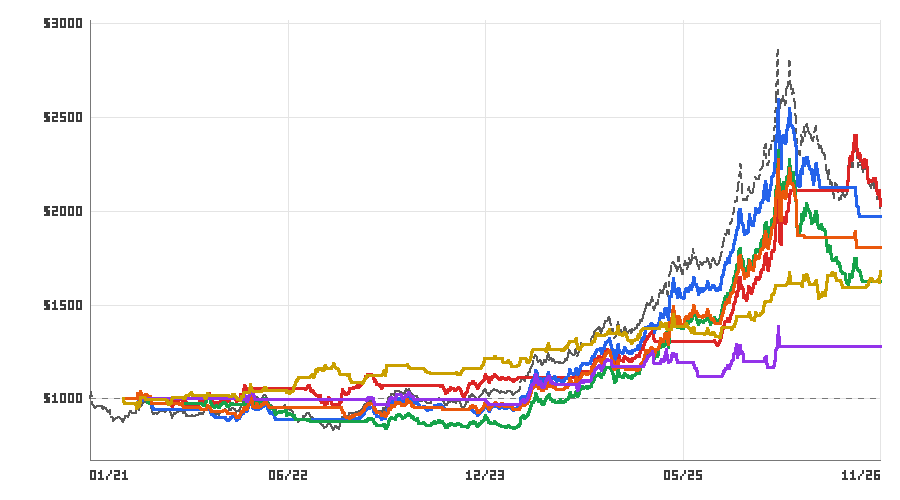

# 🥇 Gold Paper Bot (+ 🇺🇸 Nasdaq 100)

Bot Telegram qui **trade l'or et le Nasdaq 100 en simulation** (paper trading) avec plusieurs stratégies en parallèle et publie chaque
entrée, chaque sortie et un bilan régulier sur un canal Telegram. Les stratégies actives par défaut ont été choisies
par un **banc d'essai sur 6 ans** de données (voir plus bas).

> ⚠️ **Simulation uniquement.** Aucun ordre réel n'est passé, aucun compte de trading n'est utilisé.
> Ce n'est pas un conseil financier.

## Fonctionnement

```
Toutes les 3 minutes
  │
  ├─ Prix de l'or : PAXG/USD (1 PAXG = 1 once d'or) — Coinbase, secours Kraken (gratuit, sans clé)
  ├─ Stops / objectifs : vérifiés sur les bougies 5 min
  ├─ Signaux : chaque stratégie est évaluée à la clôture de chaque bougie de SON unité de temps (1 h, 6 h ou 1 jour)
  │
  └─► Ouvertures / clôtures publiées sur le canal + bilan toutes les SUMMARY_HOURS
```

- Chaque stratégie a **son propre compte simulé** : `GOLD_SIZE_USD` (1 000 $ par défaut) par trade, long ou short.
- Frais / spread simulés : 0,05 % à l'entrée et à la sortie.
- Une **référence achat-conservation** (acheter et garder) sert de point de comparaison dans le bilan.
- Les positions sont gardées dans `data/gold.json` (elles survivent à un redémarrage).

## Stratégies actives par défaut (or)

Choisies par le banc d'essai sur **25 ans d'or** (future GC=F, 2000 → 2026 : choix sur 2000–2015, vérification sur
2016–2026, `npm run research -- goldlong`) et confirmées sur le PAXG 2020–2026.

| Stratégie | Idée | 2001 → 2026 (réinvesti) | Pire baisse |
|---|---|---|---|
| **Saison de l'or** (`season`) | investi d'août à février (demande physique : Inde, Nouvel An chinois), dehors de mars à juillet | **+9,5 %/an** | **−22 %** |
| **Filtre moyenne 200 jours** (`sma200`) | investi au-dessus de la moyenne 200 j (marge 2 %) | +7,6 %/an | −39 % |
| **Momentum 12 mois** (`mom12`) | investi tant que l'or a monté sur 12 mois (Antonacci) | +7,2 %/an | −40 % |
| Momentum de tendance (`tsmom`) | prix > moyenne 200 j et hausse sur 3 mois | +5,9 %/an | −30 % |
| Nouveau plus haut annuel (`high52`) | achat au plus haut de 52 semaines, revente au plus bas de 50 jours | +5,1 %/an | −18 % |
| MACD + EMA 200 (`macd@1d`) | croisement MACD dans le sens de l'EMA 200 | +1,7 %/an | −38 % |
| *Référence : garder l'or* (`hold`) | achète une fois et garde | *+10,8 %/an* | *−44 %* |


**À retenir** : sur 25 ans, la **saison de l'or** fait presque aussi bien que garder l'or avec **deux fois moins de baisse**,
et fait mieux sur 2021–2026 (+12,9 %/an contre +12,7 %). Les stratégies choisies au départ sur seulement 4 ans de PAXG
(Dollar + or, MM 10/60, Vote, EMA 20/50) **ne tiennent pas sur 25 ans** (entre −1 et +1 %/an) : elles restent
disponibles mais ne sont plus actives. Les filtres « taux US 10 ans », « indice du dollar » et « valeur refuge (VIX) »
ont été testés et sont perdants sur 2000–2015.

Toutes les autres restent disponibles (`GOLD_STRATEGIES`, voir Réglages) : `vote`, `dollar`, `sma1060@1d`, `ema@1d`,
`fibo@6h`, `vixcalm`, `yields`, `dxy`, `fear`, `breakout`, `meanrev`, `supertrend`, `pvt`, `turtle`, `ichimoku`…,
et n'importe laquelle sur une autre unité (`ema@6h`…).

## 📈 Portefeuille (gains réinvestis)

Chaque stratégie a **son propre compte**, qui démarre avec `GOLD_START_CAPITAL` (1 000 $) et **mise tout son capital**
(`GOLD_POSITION_PCT` = 100 %) à chaque trade : les gains sont réinvestis, les pertes aussi.

- La valeur de chaque compte est enregistrée **toutes les heures** (`data/gold.json`).
- Un **graphique de l'évolution** est publié sur le canal chaque jour (`CHART_HOURS`), et à la demande avec `/portfolio`.
- `/historique [or|nasdaq] [année]` rejoue les stratégies actives sur l'historique avec réinvestissement (or : depuis 2001 avec le future GC=F, depuis 2021 avec le PAXG).

### Historique simulé 2021 → oct. 2026 (1 000 $ au départ par stratégie, frais inclus)



| | Stratégie | Valeur finale | Pire baisse |
|---|---|---|---|
| 🟪 | Croisement MM 10/60 | 2 037 $ (+104 %) | −23 % |
| ⬛ | *Référence achat-conservation* | *2 019 $ (+102 %)* | *−30 %* |
| 🟦 | Vote de 5 signaux | 1 819 $ (+82 %) | −24 % |
| 🟧 | Momentum de tendance | 1 804 $ (+80 %) | −22 % |
| 🟥 | **MACD + EMA 200** | 1 682 $ (+68 %) | **−9 %** |
| 🟩 | Dollar + or | 1 623 $ (+62 %) | −16 % |
| 🟫 | Convergence Fibonacci | 1 388 $ (+39 %) | −16 % |
| 🟨 | EMA 20/50 | 1 196 $ (+20 %) | −10 % |

Toutes gagnent, **aucune ne bat nettement le simple achat-conservation** sur une période où l'or a doublé,
mais elles subissent des baisses bien plus faibles (MACD + EMA 200 : −9 % au pire, contre −30 %).

## Banc d'essai (`npm run research`)

**Données** : PAXG/USDT en 1 h depuis l'archive publique de Binance, **sept. 2020 → oct. 2026** (54 000 bougies),
agrégées en 6 h et en journalier, + EUR/USD (même archive) pour la stratégie dollar.
**23 stratégies × 3 unités de temps = 67 combinaisons** testées.

**Méthode** : les combinaisons sont **choisies** sur sept. 2020 → juin 2024 avec une règle fixée à l'avance
(gain > 0, profit factor ≥ 1,15, ≥ 20 trades, positive ≥ 60 % des années), puis **vérifiées** sur juil. 2024 → oct. 2026,
période qu'on ne regarde pas pour choisir. Test répété avec des frais doublés et d'autres dates de coupure.

### Ce qu'on a appris
1. **En bougies 1 h, tout perd** sur la période de choix — y compris les stratégies maison. Les frais et le bruit
   mangent tout. Les 5 stratégies d'origine tournaient en 1 h : c'est pour ça qu'elles perdaient.
2. **En journalier, plusieurs stratégies gagnent.** Une seule est retenue dans **toutes** les variantes du test
   (frais 0,05 % et 0,1 %, coupures 2023, 2024, 2025) et reste positive en vérification à chaque fois :
   **MACD + EMA 200 en journalier**. Elle gagne **chaque année de 2021 à 2026**, à l'achat (+435 $) comme à la vente
   (+78 $), avec une perte maximale de 68 $ sur 6 ans.
   Le **vote de 5 signaux** (journalier) est retenu dans 3 variantes sur 4 et toujours positif en vérification ;
   **dollar + or** est positif en vérification à chaque fois mais plus sensible aux frais.
   Ichimoku, ADX, Heikin-Ashi, compression de Bollinger, alignement de moyennes et inside bar ne sont pas retenus.
3. Elles font **moins que l'achat-conservation** en valeur absolue (l'or a doublé sur la période), mais avec beaucoup
   moins de temps en position et des pertes maximales bien plus faibles.

### Résultats des stratégies actives (1 000 $ par trade, frais 0,05 %)

| Combinaison | Choix 2020→mi-2024 | Vérif mi-2024→2026 | 2021 | 2022 | 2023 | 2024 | 2025 | 2026 |
|---|---|---|---|---|---|---|---|---|
| **MACD + EMA 200 (1 j)** | **+243 $** | **+232 $** | +20 | +71 | +116 | +42 | +151 | +74 |
| **Vote de 5 signaux (1 j)** | +128 $ | +496 $ | −158 | +98 | +55 | +127 | +188 | +313 |
| Dollar + or (1 j) | +75 $ | +374 $ | −39 | +80 | +121 | +53 | +87 | +237 |
| Momentum de tendance (1 j) | +64 $ | +606 $ | −71 | −34 | +38 | +228 | +508 | +1 |
| MM 10/60 (1 j) | +73 $ | +665 $ | −92 | −4 | +3 | +193 | +146 | +482 |
| EMA 20/50 (1 j) | +221 $ | +65 $ | +97 | +18 | +63 | −58 | +41 | +95 |
| Convergence Fibonacci (6 h) | +109 $ | +246 $ | −88 | +117 | −21 | +108 | +31 | +207 |
| *Achat-conservation* | *+168 $* | *+688 $* | | | | | | |

Attention : la période de vérification est une forte hausse de l'or, qui avantage les stratégies acheteuses.
Avec 67 combinaisons testées, quelques-unes peuvent sembler bonnes par hasard : c'est pour ça que le paper trading
en direct continue de les départager. **Résultats passés ≠ résultats futurs.**

Pour relancer : `npm run research` (frais 0,05 %), `npm run research -- 0.1` (frais 0,1 %),
`npm run research -- 0.05 2023-07-01` (autre coupure). Les données sont mises en cache dans `data/research/`.

## 🇺🇸 Nasdaq 100 en paper trading

Le bot trade aussi le **Nasdaq 100** en simulation, comme un CFD NAS100 :
- Prix : **indice ^NDX** via Yahoo Finance (gratuit, sans clé, non officiel), bougies 5 min pour les stops.
- Stratégies (retenues par le banc d'essai, **achat seul** : vendre le Nasdaq à découvert fait perdre sur le long terme) :

| Stratégie | Idée | 2010–2026 (CFD) | Sans financement |
|---|---|---|---|
| **Filtre moyenne 200 jours** (`sma200`) | investi au-dessus de la moyenne 200 j (marge 2 %), dehors en dessous | **+7,0 %/an**, pire baisse −32 % | +11,3 %/an |
| **Marché calme (VIX)** (`vixcalm`) | investi quand le VIX est sous sa moyenne 50 j et l'indice au-dessus de sa moyenne 50 | +5,3 %/an, −22 % | +9,0 %/an |
| Momentum de tendance (`tsmom`) | prix > moyenne 200 et hausse sur 3 mois | +3,9 %/an, −28 % | +8,2 %/an |
| MACD + EMA 200, achat seul (`macd_long`) | croisement MACD dans le sens de l'EMA 200 | +3,6 %/an, −18 % | +5,8 %/an |
| RSI 2 (`rsi2`) | racheter un repli très court dans la tendance | +3,4 %/an, −17 % | +4,2 %/an |
| Effet de début de mois (`tom`) | acheté l'avant-dernier jour du mois, revendu au 3e jour du suivant | +3,1 %/an, −16 % | +4,3 %/an |
| Double 7 (`double7`) | plus bas de 7 j au-dessus de la moyenne 200, revente au plus haut de 7 j | +3,1 %/an, −19 % | +5,0 %/an |
| *Référence : garder l'indice* | | *+17,0 %/an, −36 %* | |

  Aussi disponibles (`NAS_STRATEGIES`) : `ibs` (IBS, +6,2 %/an mais non retenue sur la période de choix),
  `down3` (3 jours de baisse), `vixspike` (pic de peur VIX), `ema_long`. Le VIX vient de Yahoo (`^VIX`).
- Coûts : 0,01 % par côté **+ financement de nuit 6 %/an** (`NAS_FINANCING_PCT`) au prorata des jours en position.
- Messages marqués 🇺🇸 sur le canal, bilan et graphique séparés ; commande `/nasdaq`, `/historique nasdaq 2010`.

### Historique simulé 2010 → 2026 (1 000 $ au départ, gains réinvestis, frais + financement)


⚠️ **Sur le Nasdaq, garder l'indice reste devant toutes les stratégies** depuis 2010 (+17 %/an) : l'indice a été multiplié
par 14, les stratégies ne sont en position qu'une partie du temps et paient le financement du CFD. La meilleure
(filtre moyenne 200 jours) fait +7 %/an en CFD, +11 %/an sans financement, en évitant le cœur des krachs.
Le paper trading les compare en direct à la référence.

### Intraday NAS100 (formation TradingView, module 5) — `npm run nas-intraday`

Les 3 stratégies de la formation ont été codées sur bougies 5 min de l'indice (heures de New York, changement d'heure géré),
fenêtre 9:30–11:30 New York (15:30–17:30 Paris), tout fermé avant la clôture, 2 trades par jour au plus.
Test sur les **60 dernières séances** (limite gratuite de Yahoo pour le 5 min), choix sur la 1re moitié, vérification sur la 2e :

| Stratégie | Trades | Gagnants | Avant frais | Verdict |
|---|---|---|---|---|
| A. Cassure du range d'ouverture 15 min (`orb15`) | 26 | 19 % | ≈ 0 par trade | pas d'avantage, non activée |
| B. Repli VWAP / EMA 20 (`vwappb`) | 32 | 16 % | −0,22 R par trade | perdante, non activée |
| C. Chasse aux stops puis retournement (`sweep`) | 4 | 50 % | +2,25 R par trade | positive mais **4 trades seulement** : activée **à l'essai** en paper trading |

60 séances, c'est trop court pour conclure : le paper trading en direct (évalué toutes les 3 min sur les bougies 5 min)
sert à accumuler des trades. Pas de financement de nuit puisque tout est fermé le jour même.

## Banc d'essai Nasdaq 100 (`npm run research -- nas100`)

Données Yahoo Finance (gratuites) : **indice ^NDX en journalier depuis 1985** (41 ans : bulle internet, 2008, Covid, 2022)
et **future NQ en 1 h** sur ~2,4 ans. Choix sur 1985 → 2009, vérification sur 2010 → 2026 (1 h / 6 h : choix avant
août 2025). Frais 0,01 % par côté (CFD NAS100).

| Stratégie (journalier) | Vérif 2010–2026 | Après financement CFD (~6 %/an) | Remarque |
|---|---|---|---|
| **RSI 2 (achat seul)** | +728 $ | **+600 $** | en position 13 % du temps, trades de ~5 jours : le classique de Connors fonctionne sur les indices actions |
| **Momentum de tendance (achat seul)** | +1 513 $ | **+772 $** | positions longues (~51 jours) : le financement coûte cher |
| **MACD + EMA 200** | +820 $ | +433 $ | ventes à découvert perdantes (−207 $) : en version achat seul ce serait mieux |
| PVT + EMA 50 | +739 $ | +350 $ | |
| Momentum achat + vente, Turtle | +643 $ / +275 $ | **négatif** | vendre le Nasdaq à découvert coûte plus que ça ne rapporte |

**À retenir**
- Comme pour l'or, **le journalier marche, l'intraday beaucoup moins** (1 h / 6 h : historique court, résultats faibles).
- **MACD + EMA 200 en journalier est retenue sur les deux marchés**, ce qui renforce la confiance en elle.
- Le Nasdaq monte sur le long terme : **les ventes à découvert font perdre**, les versions « achat seul » sont meilleures.
- Avec un CFD, **le financement de nuit** réduit fortement les gains des stratégies qui gardent longtemps
  (un future NQ ou un ETF comme QQQ n'a pas ce coût).
- Les montants sont en « 1 000 $ par trade » (sans réinvestissement), donc non comparables directement à
  l'achat-conservation de l'indice, qui a été multiplié par ~100 depuis 1985.

## Scalp (bougies 1 et 5 min) — testé, non retenu (`npm run scalp`)

6 stratégies de scalp testées, uniquement pendant les séances de Londres et New York (7 h–20 h UTC), tout fermé le soir :
EMA 9/21 + VWAP, retour au VWAP (±2 écarts-types + RSI 7), Bollinger + RSI 7, cassure du range d'ouverture
(Londres 07:00 / New York 13:30 UTC), stochastique dans la tendance, accélération sur 3 bougies.

Données : PAXG 5 min sur 6 ans (648 000 bougies) et 1 min sur 12 mois (525 000 bougies), avec choix / vérification.
Frais testés par côté : 0,005 % (compte ECN XAU/USD), 0,01 % (broker CFD classique), 0,05 % (PAXG crypto).

| Constat | Détail |
|---|---|
| Une bougie 5 min bouge en moyenne de 0,056 %, une bougie 1 min de 0,014 % | avec 0,05 % de frais par côté, il faudrait gagner ~2 bougies 5 min entières par trade juste pour payer les frais |
| 5 des 6 stratégies perdent **avant même les frais** en 5 min | gain moyen par trade négatif |
| Seule **Bollinger + RSI 7 (5 min)** a un petit avantage brut : +0,0245 % par trade | supporte au maximum ~0,012 % de frais par côté ; en vérification : +94 $ avec un compte ECN, −313 $ avec un broker classique |
| En 1 min, rien ne fonctionne | gains bruts quasi nuls (≤ 0,007 % par trade) |

**Conclusion : pas de stratégie de scalp viable sur l'or avec ces règles**, et aucune n'est activée dans le bot.
Le scalp ne peut se jouer qu'avec des frais quasi nuls et une exécution très rapide, ce que le paper trading
toutes les 3 minutes ne reproduit pas. À noter : le PAXG sur Binance est moins liquide que l'or « réel »
(XAU/USD), donc ses bougies 1 min ne reflètent qu'imparfaitement le scalp sur l'or.

Avec des frais de broker (0,01 %), les stratégies en 1 h restent elles aussi presque toutes perdantes ;
les stratégies journalières restent les meilleures (`npm run research -- 0.01`).

## Commandes Telegram

| Commande | Rôle |
|---|---|
| `/nasdaq` | Bilan du Nasdaq 100 |
| `/gold` | Bilan de chaque stratégie (valeur du compte, trades, % gagnants, position en cours) |
| `/portfolio` | Graphique de l'évolution du portefeuille depuis le lancement |
| `/historique [or\|nasdaq] [année]` | Simulation des stratégies actives sur l'historique (gains réinvestis), avec graphique |
| `/strategies` | Description des stratégies actives |
| `/backtest [jours]` | Backtest récent sur Coinbase (90 jours par défaut, 365 max) |
| `/bilan` | Publie le bilan sur le canal maintenant |
| `/testcanal` | Message de test sur le canal |
| `/settings` | Paramètres actifs |
| `/pause` / `/resume` | Coupe / relance les publications (le paper trading continue) |

## Ce dont le bot a besoin

| Besoin | Pourquoi |
|---|---|
| Un hébergement allumé 24h/24 (ex : Bot-Hosting, serveur **Node.js**) | vérifier les stops toutes les 3 min |
| Node.js 20 ou plus | faire tourner le code |
| Token du bot (@BotFather) + canal / groupe Telegram où le bot peut publier | publier les trades |
| Accès internet à Coinbase / Kraken | prix de l'or et EUR/USD (gratuit, sans clé) |
| ~100 Mo de RAM, quelques Mo de disque | mémoire des positions |

Les stratégies journalières tradent peu : quelques trades par mois au total. C'est normal.

Pour trader un jour en **argent réel**, il faudrait en plus un compte chez un broker avec API pour l'or
(CFD XAU/USD, ou PAXG sur un exchange), des clés API, du capital et des limites de risque. Ce n'est pas branché.

## Installation

```bash
git clone https://github.com/OffNorth/idk.git && cd idk
npm install
cp .env.example .env   # renseigner TELEGRAM_BOT_TOKEN, TELEGRAM_CHANNEL_ID, ALLOWED_TELEGRAM_USER_IDS
npm start
```

Au démarrage, la console affiche `✅ Canal « … » : publication autorisée.` puis `Bot @… démarré.`

Sur **Bot-Hosting** : serveur de type **Node.js** (pas Java), fichier de démarrage `bot.js`, `.env` créé dans *Files*,
puis *Restart*. Le serveur gratuit doit être renouvelé tous les 4 jours.

### Mode secours : GitHub Actions
`.github/workflows/scanner.yml` (« Paper trading or ») fait un passage toutes les 10 min sur les serveurs de GitHub,
sans les commandes Telegram. À n'activer **que si le bot ne tourne pas ailleurs**, sinon les trades sont publiés en
double. Secrets à créer : `TELEGRAM_BOT_TOKEN`, `TELEGRAM_CHANNEL_ID`.

## Réglages (`.env`)

| Variable | Défaut | Rôle |
|---|---|---|
| `GOLD_STRATEGIES` | `season,sma200,mom12,tsmom,high52,macd@1d,hold` | Stratégies actives (`id` ou `id@1h/6h/1d`, ou `all`) |
| `GOLD_START_CAPITAL` | 1000 | Capital de départ de chaque stratégie (gains réinvestis) |
| `GOLD_POSITION_PCT` | 100 | Part du capital misée à chaque trade (%) |
| `CHART_HOURS` | 24 | Graphique du portefeuille sur le canal (0 = jamais) |
| `GOLD_FEE_PCT` | 0.05 | Frais / spread par côté (%) |
| `CHECK_INTERVAL_MINUTES` | 3 | Fréquence de vérification |
| `SUMMARY_HOURS` | 4 | Bilan sur le canal (0 = jamais) |

## Structure

```
bot.js             Bot Telegram + passage toutes les CHECK_INTERVAL_MINUTES
once.js            Un seul passage (GitHub Actions / cron)
backtest.js        Backtest récent (Coinbase) en console
research.js        Banc d'essai complet (or : archive Binance · nas100 : Yahoo Finance), choix / vérification
scalp.js           Banc d'essai du scalp (1 / 5 min, plusieurs niveaux de frais)
nas-intraday.js    Test des 3 stratégies intraday NAS100 (60 dernières séances)
src/gold.js        Moteur de paper trading multi-unités de temps + backtest
src/strategies.js  Toutes les stratégies (guides, classiques, maison) + référence
src/indicators.js  EMA, SMA, RSI, ATR, Bollinger, MACD, Donchian, Supertrend, PVT, chandeliers, sessions…
src/history.js     Téléchargement / cache de l'archive Binance, agrégation 6 h / 1 j
src/yahoo.js       Données Yahoo Finance (Nasdaq 100 et autres indices)
src/cycle.js       Un passage : trading + bilan + graphique
src/portfolio.js   Graphique du portefeuille en direct et historique simulé (par marché)
src/intraday.js    Indicateurs et stratégies intraday NAS100 (VWAP, range d'ouverture, sweep…)
src/markets.js     Marchés : or (Coinbase/Kraken) et Nasdaq 100 (Yahoo), stratégies, frais, financement
src/chart.js       Rendu PNG des courbes (sans dépendance)
src/channel.js     Publication Telegram
src/format.js      Messages Telegram
src/store.js       Fichiers JSON du dossier data/
src/config.js      Lecture du .env
```
